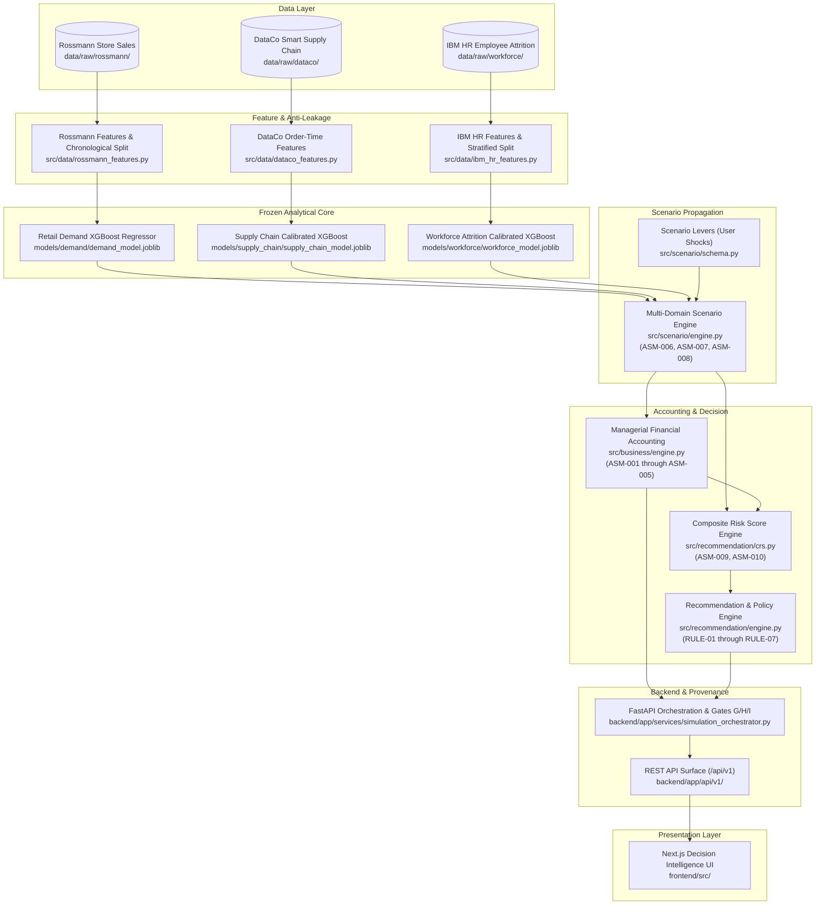

# DecisionSphere — Comprehensive Research System Map
**Authoritative Architectural Blueprint & End-to-End Analytical Chain**
*Status: Locked & Verified | Epistemic Integrity Level: Tier 1–6 Grounded | Milestone: Research & Publication Phase*

---

## 1. Executive Overview & System Architecture

DecisionSphere is an AI-powered strategic decision-support platform designed to evaluate multi-domain enterprise trade-offs under user-specified hypothetical scenarios. Modern enterprises plan commercial promotions, supply chain fulfillment logistics, and workforce scheduling in organizational silos. DecisionSphere provides a unified, cross-domain simulation environment that models how commercial demand shocks propagate across logistics operations and workforce capacity, translating operational strain into deterministic managerial financial accounting and evidence-backed strategic recommendations.



---

## 2. The 13-Stage Authoritative Analytical Chain

The entire platform functions as a single, unbroken chain of data flow and mathematical transformation. analytical authority resides strictly within the backend services and frozen models; notebooks and frontend components consume or explain this authoritative chain without altering any logic.

| Stage | Stage Name | Governing Source Files | Primary Artifacts / Outputs | Epistemic Tier |
|---|---|---|---|---|
| **1** | Raw Dataset Ingestion | `data/dataset_manifest.json`, `data/raw/` | 3 primary benchmark datasets | `OBSERVED` |
| **2** | Preprocessing & Loading | `src/data/*_loader.py` | Validated, sorted dataframes | `OBSERVED` |
| **3** | Feature Engineering | `src/data/*_features.py` | Anti-leakage predictor matrices | `OBSERVED` |
| **4** | Serialized Models | `models/*/*.joblib` | 3 frozen XGBoost models + calibrators | `PREDICTED` |
| **5** | Inference Services | `src/models/*/inference.py` | Prediction engines & threshold checks | `PREDICTED` |
| **6** | Scenario Levers | `src/scenario/schema.py` | Strongly typed levers & assumptions | `ASSUMED` |
| **7** | Cross-Domain Propagation | `src/scenario/engine.py` | Coupled multi-domain predictions | `PROPAGATED` |
| **8** | Financial Accounting | `src/business/engine.py` | Dollar revenue, costs, net profit delta | `CALCULATED` |
| **9** | Composite Risk Scoring | `src/recommendation/crs.py` | Multi-criteria operational strain (CRS) | `CALCULATED` |
| **10** | Recommendation Rules | `src/recommendation/rules.py`, `engine.py` | Strategic actions & decision gating | `RECOMMENDED` |
| **11** | Provenance & Quality Gates | `backend/app/services/simulation_orchestrator.py` | $\Sigma_{\text{run}}$ audit tuple, Gates G/H/I | `CALCULATED` |
| **12** | API Interface | `backend/app/api/v1/endpoints/` | 21 validated JSON REST endpoints | Varied |
| **13** | Presentation Layer | `frontend/src/app/`, `frontend/src/components/` | Decision Hero, cards, waterfall table | All Tiers |

---

## 3. Detailed Stage-by-Stage Architecture Mapping

### Stage 1: Raw Datasets & Ingestion Registry
- **Repository Location:** [`data/dataset_manifest.json`](file:///d:/Projects/DecisionSphere/data/dataset_manifest.json#L1-L136), [`data/raw/`](file:///d:/Projects/DecisionSphere/data/raw/)
- **Audited Datasets:**
  1. **Demand Forecasting:** Rossmann Store Sales
     - Path: `data/raw/rossmann/train.csv` (1,017,209 rows, 9 cols), `data/raw/rossmann/store.csv` (1,115 rows, 10 cols).
     - Temporal Span: 2013-01-01 to 2015-07-31 (Daily).
     - Target: `Sales` (Continuous Float, Mean: $5,773.82$, Min: $0$, Max: $41,551.00$).
     - Rationale: High-frequency daily cadence, explicit promotional lever (`Promo`), zero missing values in transaction train table.
  2. **Supply Chain Delivery Risk:** DataCo Smart Supply Chain
     - Path: `data/raw/dataco/DataCoSupplyChainDataset.csv` (180,519 rows, 53 cols).
     - Temporal Span: 2015-01-01 to 2018-01-31 (Order Item Transaction).
     - Target: `Late_delivery_risk` (Binary Integer: 0 = On Time [45.17%], 1 = Late [54.83%]).
     - Rationale: End-to-end global order fulfillment tracking, explicit shipping modes, balanced late delivery class distribution.
  3. **Workforce Analytics:** IBM HR Employee Attrition & Performance
     - Path: `data/raw/workforce/WA_Fn-UseC_-HR-Employee-Attrition.csv` (1,470 rows, 35 cols).
     - Cross-sectional Benchmark.
     - Target: `Attrition` (Binary String: 'Yes' [16.12%, 237 rows], 'No' [83.88%, 1,233 rows]).
     - Rationale: Gold-standard workforce benchmark; contains direct operational workload lever `OverTime` (baseline attrition without overtime: $10.4\%$, with overtime: $30.5\%$).

---

### Stage 2: Data Preprocessing & Ingestion Loaders
- **Rossmann Loader:** [`src/data/rossmann_loader.py`](file:///d:/Projects/DecisionSphere/src/data/rossmann_loader.py#L5-L88)
  - `load_rossmann_raw()`: Reads raw CSVs, parses `Date` ascending, standardizes `StateHoliday` strings, validates numerical column types.
  - `merge_store_metadata()`: Imputes `CompetitionDistance` using store median, calculates `LogCompetitionDistance` ($\log(1 + x)$), resolves `CompetitionOpen` calendar flag, and computes `Promo2Active` indicator matching active promotion interval months.
- **DataCo Loader:** [`src/data/dataco_loader.py`](file:///d:/Projects/DecisionSphere/src/data/dataco_loader.py#L10-L63)
  - `extract_dataco_raw()`: Auto-extracts from reference zip archive if needed.
  - `load_dataco_raw()`: Reads Latin1 encoding, asserts structural integrity (exactly 180,519 rows $\times$ 53 cols), verifies binary target $\{0, 1\}$, and parses order timestamp `order_dt` (`order date (DateOrders)`).
- **IBM HR Loader:** [`src/data/ibm_hr_loader.py`](file:///d:/Projects/DecisionSphere/src/data/ibm_hr_loader.py#L17-L86)
  - `load_ibm_hr_raw()`: Asserts shape integrity (1,470 rows $\times$ 35 cols), asserts zero missing values across all columns, and asserts target split (237 'Yes' vs 1,233 'No').

---

### Stage 3: Feature Engineering & Anti-Leakage Controls
- **Rossmann Feature Engineering:** [`src/data/rossmann_features.py`](file:///d:/Projects/DecisionSphere/src/data/rossmann_features.py#L6-L177)
  - *Prohibited Lookahead Dropped:* `Customers` (unavailable at horizon forecast start).
  - *Predictors (20 columns):*
    - Calendar (7): `DayOfWeek`, `Month`, `Day`, `WeekOfYear`, `IsWeekend`, `IsMonthStart`, `IsMonthEnd`.
    - Event (4): `Promo`, `Promo2`, `Promo2Active`, `SchoolHoliday`.
    - Store (5): `LogCompetitionDistance`, `CompetitionOpen`, `StoreType_Encoded`, `Assortment_Encoded`, `StateHoliday_Encoded`.
    - Historical Lags (4): `Sales_lag_1`, `Sales_lag_7`, `Sales_lag_14`, `Sales_lag_28` (grouped by Store, strictly shifted $\ge 1$ day).
    - Historical Rolling (3): `Sales_rolling_mean_7`, `Sales_rolling_mean_14`, `Sales_rolling_std_7` (strictly shifted by 1 day to exclude day $t$).
  - *Data Split:* Chronological forward split via `split_chronological()`:
    - Train: $\le 2014-10-19$ ($\approx 70\%$)
    - Validation: $2014-10-20$ to $2015-03-10$ ($\approx 15\%$)
    - Test: $> 2015-03-10$ ($\approx 15\%$)
- **DataCo Feature Engineering:** [`src/data/dataco_features.py`](file:///d:/Projects/DecisionSphere/src/data/dataco_features.py#L9-L188)
  - *Prohibited Lookahead Dropped:* `Days for shipping (real)` (encodes actual delivery outcome), `Delivery Status` (100% deterministic target leak), `shipping date (DateOrders)` (post-order timestamp), `Order Status` (realized fulfillment).
  - *Prohibited Accounting Dropped:* `Benefit per order`, `Order Profit Per Order`, `Order Item Profit Ratio`, `Sales per customer`.
  - *Prohibited Identifiers Dropped:* `Customer Email`, `Customer Id`, `Order Id`, `Order Item Id`, `Product Card Id`, etc.
  - *Order-Time Predictors (22 columns):*
    - Numerical (12): `days_for_shipment_scheduled`, `order_item_quantity`, `order_item_product_price`, `order_item_discount_rate`, `order_item_total`, `product_price`, `latitude`, `longitude`, `order_year`, `order_month`, `order_day_of_week`, `order_hour`.
    - Categorical (10): `type`, `shipping_mode`, `customer_segment`, `customer_country`, `customer_state`, `market`, `order_region`, `order_country`, `department_id`, `category_id`.
  - *Data Split:* Chronological forward split via `split_chronological_dataco()`:
    - Train: $2015-01-01$ to $2016-12-31$ (125,200 rows, $69.4\%$)
    - Validation: $2017-01-01$ to $2017-06-30$ (30,950 rows, $17.1\%$)
    - Test: $2017-07-01$ to $2018-01-31$ (24,369 rows, $13.5\%$)
- **IBM HR Feature Engineering:** [`src/data/ibm_hr_features.py`](file:///d:/Projects/DecisionSphere/src/data/ibm_hr_features.py#L12-L203)
  - *Prohibited Zero-Variance Dropped:* `EmployeeCount` ($=1$), `StandardHours` ($=80$), `Over18` ($='Y'$).
  - *Prohibited Surrogate Dropped:* `EmployeeNumber` (memorization risk).
  - *Predictors (30 columns):*
    - Numerical (23): `Age`, `DailyRate`, `DistanceFromHome`, `Education`, `EnvironmentSatisfaction`, `HourlyRate`, `JobInvolvement`, `JobLevel`, `JobSatisfaction`, `MonthlyIncome`, `MonthlyRate`, `NumCompaniesWorked`, `PercentSalaryHike`, `PerformanceRating`, `RelationshipSatisfaction`, `StockOptionLevel`, `TotalWorkingYears`, `TrainingTimesLastYear`, `WorkLifeBalance`, `YearsAtCompany`, `YearsInCurrentRole`, `YearsSinceLastPromotion`, `YearsWithCurrManager`.
    - Categorical (7): `BusinessTravel`, `Department`, `EducationField`, `Gender`, `JobRole`, `MaritalStatus`, `OverTime`.
  - *Data Split:* Stratified split on `target_attrition` via `split_stratified_ibm_hr()`:
    - Train: 1,029 rows ($70.0\%$)
    - Validation: 220 rows ($15.0\%$)
    - Test: 221 rows ($15.0\%$)

---

### Stage 4: Serialized Models & Cryptographic Fingerprints
- **Configuration Contract:** [`backend/app/core/config.py`](file:///d:/Projects/DecisionSphere/backend/app/core/config.py#L108-L133)
- **Model Descriptors:**
  1. **Demand Forecasting Model:**
     - Key: `demand`
     - Artifact File: `models/demand/demand_model.joblib`
     - Authoritative SHA-256: `FB438C03A742202657BB4EF9196FF17E004BC090E99218F02985DC7720F41941`
     - Algorithm: `XGBRegressor(n_estimators=300, max_depth=6, learning_rate=0.05, subsample=0.8)`
     - Metric: Weighted Absolute Percentage Error (WAPE) = $8.12\%$ on holdout test.
  2. **Supply Chain Delivery Risk Model:**
     - Key: `supply_chain`
     - Artifact File: `models/supply_chain/supply_chain_model.joblib`
     - Authoritative SHA-256: `0052E641CF355257ABB332703C3E6A46C65E9AB10A975227D83CF77D7E689B59`
     - Algorithm: `CalibratedClassifierCV(base_estimator=XGBClassifier, method='sigmoid', cv='prefit')`
     - Decision Threshold $\tau^*$: $0.1700$ (Optimal F1-score operating point)
     - Metrics: ROC-AUC = $0.7795$, PR-AUC = $0.8423$, Brier Score = $0.1873$.
  3. **Workforce Attrition Risk Model:**
     - Key: `workforce`
     - Artifact File: `models/workforce/workforce_model.joblib`
     - Authoritative SHA-256: `4B195C7BEE3AB8F4AFE75CCD0C75FFF0C8E18B9FCA88A00305E165A010109918`
     - Algorithm: `CalibratedClassifierCV(base_estimator=XGBClassifier, method='sigmoid', cv='prefit')`
     - Decision Threshold $\tau^*$: $0.2100$
     - Metrics: ROC-AUC = $0.8045$, PR-AUC = $0.5030$, Top Driver: `OverTime` (SHAP value $+0.4450$).

---

### Stage 5: Inference Services & Prediction Layer
- **Demand Forecaster:** [`src/models/demand/inference.py`](file:///d:/Projects/DecisionSphere/src/models/demand/inference.py#L8-L216)
  - `predict_horizon()`: Executes recursive autoregressive multi-step forecast over 14 days. Predictions $\hat{y}_t$ are appended to the historical buffer to dynamically construct lag features ($t-1, t-7, t-14, t-28$) and rolling statistics for step $t+1$. Enforces closed-store logic ($\text{Open}=0 \implies \hat{y}=0$).
  - `simulate_conditional_scenario()`: Compares baseline ($\text{Promo}=0$) against scenario ($\text{Promo}=1$).
- **Supply Chain Inference Service:** [`src/models/supply_chain/inference.py`](file:///d:/Projects/DecisionSphere/src/models/supply_chain/inference.py#L9-L216)
  - `predict_batch()`: Preprocesses feature vectors through saved `ColumnTransformer` (OneHotEncoder + StandardScaler) and applies Sigmoid Platt scaling calibration to evaluate conditional late-delivery probability $P(\text{Late} \mid X)$.
  - `evaluate_monotonicity()`: Diagnostic tool checking model response to lead-time variations.
- **Workforce Inference Service:** [`src/models/workforce/inference.py`](file:///d:/Projects/DecisionSphere/src/models/workforce/inference.py#L16-L199)
  - `predict_batch()`: Evaluates employee attrition probability $P(\text{Attrition} \mid X)$.
  - `simulate_scenario()`: Assesses probability shifts under hypothetical workload overrides (`OverTime='Yes'`, `PercentSalaryHike`).

---

### Stage 6: Scenario Levers & Baseline Constants
- **Schema Contracts:** [`src/scenario/schema.py`](file:///d:/Projects/DecisionSphere/src/scenario/schema.py#L10-L75), [`src/scenario/assumptions.py`](file:///d:/Projects/DecisionSphere/src/scenario/assumptions.py#L28-L122)
- **User Levers (`ScenarioLevers`):**
  - `demand_growth_pct`: User promotional demand multiplier shock (Default: `0.0%`, Bounds: $[-50.0\%, +100.0\%]$).
  - `promo_active`: Binary toggle indicating promotional campaign flag (Default: `False`).
  - `scheduled_days_offset`: Order dispatch schedule compression or relaxation (Default: `0` days, Bounds: $[-2, +5]$).
  - `shipping_mode_override`: Freight override (`'Standard Class'`, `'Second Class'`, `'First Class'`, `'Same Day'`, or `None`).
  - `overtime_workforce_pct`: Target percentage of employee cohort assigned to mandatory overtime (Default: `29.41%` [baseline], Bounds: $[0.0\%, 100.0\%]$).
  - `salary_hike_override`: Retention compensation override (Default: `None`, Bounds: $[0.0\%, 35.0\%]$).
- **Coupling Assumptions Registry (`ASM-001` through `ASM-008`):**
  - `ASM-001`: $C_{\text{delay\_penalty}} = \$25.00/\text{delayed order}$ (Contractual 3PL late penalty).
  - `ASM-002`: $C_{\text{expedite\_fee}} = \$15.00/\text{expedited order}$ (Air freight surcharge).
  - `ASM-003`: $\kappa_{\text{stockout}} = 0.15$ ($15\%$ cancellation churn per late probability).
  - `ASM-004`: $C_{\text{replacement}} = \$30,000.00/\text{departed employee}$ (Turnover replacement drag).
  - `ASM-005`: $R_{\text{overtime}} = \$45.00/\text{hour}$ (FLSA 1.5x premium on $\$30/\text{hr}$ base wage; $h_{\text{ot}} = 20.0$ hours/cycle).
  - `ASM-006`: $\Delta_{\text{WLB}} = -1$ (WorkLifeBalance ordinal decrement for overtime workers).
  - `ASM-007`: $\gamma_{\text{volume}} = 0.10$ orders / sales unit (Normalization scaling bridge).
  - `ASM-008`: $\tau_{\text{cycle}} = 30$ days (Planning cycle temporal alignment factor).

---

### Stage 7: Cross-Domain Propagation Engine
- **Implementation:** [`src/scenario/engine.py`](file:///d:/Projects/DecisionSphere/src/scenario/engine.py#L219-L483)
- **Mathematical Cascade:**
  1. *Demand Forecast Execution:*
     $$Y_{\text{base}} = \sum_{t=1}^{14} \hat{y}_t(\text{Promo}=0)$$
     $$Y_{\text{sim}} = \left( \sum_{t=1}^{14} \hat{y}_t(\text{Promo}=\text{active}) \right) \times (1 + \Delta_{\text{growth}})$$
  2. *Enterprise Volume Normalization (ASM-008 & ASM-007):*
     $$\text{DailyRate} = \frac{Y_{\text{sim}}}{14}$$
     $$\text{NormalizedCycleVolume} = \text{DailyRate} \times \tau_{\text{cycle}} \quad (\tau_{\text{cycle}}=30)$$
     $$N_{\text{orders}} = \text{NormalizedCycleVolume} \times \gamma_{\text{volume}} \quad (\gamma_{\text{volume}}=0.10)$$
  3. *Supply Chain Dispatch Simulation:*
     - Order cohort adjusted by `scheduled_days_offset` and `shipping_mode_override`.
     - Infer mean late delivery probability: $P_{\text{late}} = \frac{1}{|O|} \sum_{i \in O} P(\text{Late} \mid X_i)$.
  4. *Workforce Deterministic Overtime Assignment:*
     - Calculate target overtime headcount: $k_{\text{target}} = \lceil N_{\text{headcount}} \times (\text{overtime\_pct} / 100) \rceil$.
     - If $k_{\text{target}} > k_{\text{base}}$, switch the first $k_{\text{target}} - k_{\text{base}}$ employees with `OverTime='No'` to `'Yes'`.
     - Apply `ASM-006`: Decrement `WorkLifeBalance` by 1 level (clipped to $[1, 4]$) for all overtime workers.
     - Infer mean attrition probability: $P_{\text{att}} = \frac{1}{|W|} \sum_{j \in W} P(\text{Attrition} \mid X_j)$.

---

### Stage 8: Financial Accounting Engine
- **Implementation:** [`src/business/engine.py`](file:///d:/Projects/DecisionSphere/src/business/engine.py#L66-L383)
- **Traceable Financial Accounting Equations:**
  1. *Gross Revenue:*
     $$\text{GrossRevenue} = Y_{\text{sales}} \times \text{unit\_price} \quad (\text{unit\_price}=\$1.00)$$
  2. *Fulfillment Loss & Realized Revenue (ASM-003):*
     $$L_{\text{fulfillment}} = \min(1.0, P_{\text{late}} \times \kappa_{\text{stockout}}) \quad (\kappa_{\text{stockout}}=0.15)$$
     $$\text{RealizedRevenue} = \text{GrossRevenue} \times (1 - L_{\text{fulfillment}})$$
  3. *Cost of Goods Sold (COGS) — Option B (Realized Sales):*
     $$\text{COGS} = \text{RealizedRevenue} \times \text{cogs\_ratio} \quad (\text{cogs\_ratio}=0.60)$$
     $$\text{GrossMargin} = \text{RealizedRevenue} - \text{COGS}$$
  4. *Supply Chain Disruption Costs (ASM-001 & ASM-002):*
     $$N_{\text{deliv\_delayed}} = N_{\text{orders}} \times P_{\text{late}} \times (1 - \kappa_{\text{stockout}})$$
     $$\text{CarrierPenalty} = N_{\text{deliv\_delayed}} \times C_{\text{delay\_penalty}} \quad (\$25.00/\text{order})$$
     $$\text{ExpediteCost} = N_{\text{expedited}} \times C_{\text{expedite\_fee}} \quad (\$15.00/\text{order})$$
     $$\text{SupplyChainCost} = \text{CarrierPenalty} + \text{ExpediteCost}$$
  5. *Workforce Operational Costs (ASM-004 & ASM-005):*
     $$\text{TurnoverCost} = (N_{\text{headcount}} \times P_{\text{att}}) \times C_{\text{replacement}} \quad (\$30,000/\text{departure})$$
     $$\text{OvertimeCost} = (K_{\text{ot}} \times h_{\text{ot}}) \times R_{\text{overtime}} \quad (20\,\text{hrs} \times \$45/\text{hr} = \$900/\text{worker})$$
     $$\text{WorkforceCost} = \text{TurnoverCost} + \text{OvertimeCost}$$
  6. *Total Operational Expense & Net Profit Delta:*
     $$\text{TotalCost} = \text{COGS} + \text{SupplyChainCost} + \text{WorkforceCost}$$
     $$\Delta \text{Profit} = \Delta \text{RealizedRevenue} - \Delta \text{TotalCost} = \Delta \text{GrossMargin} - \Delta \text{SupplyChainCost} - \Delta \text{WorkforceCost}$$

---

### Stage 9: Operational Risk & Composite Risk Score (CRS)
- **Implementation:** [`src/recommendation/crs.py`](file:///d:/Projects/DecisionSphere/src/recommendation/crs.py#L23-L137)
- **Risk Sub-Index Normalization:**
  1. *Supply Chain Strain Sub-Index ($S_{\text{supply}} \in [0, 100]$):*
     $$S_{\text{supply}} = 100 \times \left[ 0.70 \cdot P_{\text{late}} + 0.30 \cdot \text{clamp}\left(\frac{\Delta P_{\text{late}}}{0.30}, 0, 1\right) \right]$$
  2. *Workforce Strain Sub-Index ($S_{\text{workforce}} \in [0, 100]$):*
     $$S_{\text{workforce}} = 100 \times \left[ 0.60 \cdot \text{clamp}\left(\frac{P_{\text{att}}}{0.40}, 0, 1\right) + 0.40 \cdot \text{clamp}\left(\frac{\text{OT\_pct}}{100}, 0, 1\right) \right]$$
  3. *Demand Fulfillment Strain Sub-Index ($S_{\text{demand}} \in [0, 100]$):*
     $$S_{\text{demand}} = 100 \times \left[ 0.50 \cdot \text{clamp}\left(\frac{\max(0, \Delta_{\text{demand}})}{50}, 0, 1\right) + 0.50 \cdot \text{clamp}\left(\frac{L_{\text{fulfillment}}}{0.20}, 0, 1\right) \right]$$
  4. *Aggregate Composite Risk Score (ASM-009):*
     $$\text{CRS} = w_{\text{supply}} S_{\text{supply}} + w_{\text{workforce}} S_{\text{workforce}} + w_{\text{demand}} S_{\text{demand}} \quad (0.40, 0.40, 0.20)$$
     - Risk Bands: Low ($<30$), Moderate ($30-49$), High ($50-74$), Severe ($\ge 75$).

---

### Stage 10: Recommendation Rules & Lexicographic Gating
- **Implementation:** [`src/recommendation/rules.py`](file:///d:/Projects/DecisionSphere/src/recommendation/rules.py#L29-L305), [`src/recommendation/engine.py`](file:///d:/Projects/DecisionSphere/src/recommendation/engine.py#L30-L181)
- **Lexicographic Decision Hierarchy (ADR-003):**
  - **Gate 1 (Bottom-Line Profitability):** If $\Delta \text{Profit} \le 0 \implies \mathbf{REJECT\_RESTRUCTURE}$
  - **Gate 2 (Operational Strain):** Else if $\text{CRS} \le \tau_{\text{risk}}$ ($50.0$) $\implies \mathbf{PROCEED}$
  - **Gate 3 (Mitigated Execution):** Else $\implies \mathbf{PROCEED\_WITH\_MITIGATIONS}$
- **The 7 Deterministic Trigger Rules:**
  - `RULE-01` $\rightarrow$ `ACT-SC-001` (Severity: HIGH): Transition to Expedited Air Freight if $P_{\text{late}} \ge 0.65$ or ($\Delta P_{\text{late}} \ge 0.15$ and not First Class).
  - `RULE-02` $\rightarrow$ `ACT-SC-002` (Severity: MEDIUM): Increase Safety Stock Reorder Buffers if $L_{\text{fulfillment}} \ge 0.10$.
  - `RULE-03` $\rightarrow$ `ACT-WF-001` (Severity: HIGH): Cap Overtime at $20\%$ & Authorize Contract Staffing if $P_{\text{att}} \ge 0.21$ and Overtime $\ge 30\%$.
  - `RULE-04` $\rightarrow$ `ACT-FIN-001` (Severity: CRITICAL): Margin Erosion Alert: Rescale Promotional Intensity if $\Delta \text{RealizedRevenue} > 0$ and $\Delta \text{Profit} < 0$.
  - `RULE-05` $\rightarrow$ `ACT-WF-002` (Severity: MEDIUM): Targeted Retention Salary Adjustment if $P_{\text{att}} \ge 0.25$ and no salary hike specified.
  - `RULE-06` $\rightarrow$ `ACT-GOV-001` (Severity: HIGH): Operational Strain Warning: Mandate Execution Buffers if $\Delta \text{Profit} > 0$ and $\text{CRS} \ge 60.0$.
  - `RULE-07` $\rightarrow$ `ACT-SC-003` (Severity: MEDIUM): Relax Compressed Dispatch SLA if $\text{ScheduledOffset} \le -2$ and $P_{\text{late}} \ge 0.55$.

---

### Stage 11: Cryptographic Provenance & Quality Gates
- **Implementation:** [`backend/app/services/simulation_orchestrator.py`](file:///d:/Projects/DecisionSphere/backend/app/services/simulation_orchestrator.py#L53-L310)
- **Quality Gates:**
  - **Gate G:** Scenario and Policy Version Immutability (Scenarios and policies are versioned; modifying parameters generates an immutable new row).
  - **Gate H:** Relational System of Record & Audit Tuple $\Sigma_{\text{run}}$:
    $$\Sigma_{\text{run}} = \langle V_{\text{scen\_id}}, H_{\text{artifacts}}, P_{\text{id}}, P_{\text{ver}}, C_{\text{git}}, V_{\text{app}}, V_{\text{python}}, R_{\text{alembic}}, T_{\text{utc}} \rangle$$
  - **Gate I:** Startup and Pre-Execution Model Integrity Interlock (Verifies disk file SHA-256 matches frozen registry; halts execution on mismatch).

---

### Stage 12: Backend FastAPI REST API Surface
- **API Prefix:** `/api/v1` (Mounted in [`backend/app/api/v1/api_router.py`](file:///d:/Projects/DecisionSphere/backend/app/api/v1/api_router.py#L17-L33))
- **Endpoint Registry (21 Endpoints):**
  1. `GET /api/v1/health` — System status, uptime, database check.
  2. `GET /api/v1/models` — Artifact existence and SHA-256 verification report.
  3. `GET /api/v1/scenarios` — Paginated list of scenarios.
  4. `POST /api/v1/scenarios` — Create new strategic scenario.
  5. `GET /api/v1/scenarios/{id}` — Retrieve scenario details and versions.
  6. `PATCH /api/v1/scenarios/{id}` — Rename or update metadata.
  7. `DELETE /api/v1/scenarios/{id}` — Archive scenario (soft delete).
  8. `POST /api/v1/scenarios/{id}/versions` — Create immutable parameter version (Gate G).
  9. `GET /api/v1/policies` — List assumption policies (`ASM-001` to `ASM-010`).
  10. `POST /api/v1/policies` — Create new corporate policy version.
  11. `GET /api/v1/policies/active` — Fetch currently active policy.
  12. `GET /api/v1/policies/{id}` — Fetch policy details by ID.
  13. `PUT /api/v1/policies/{id}/activate` — Designate policy as active.
  14. `POST /api/v1/simulations/run` — Run simulation synchronously and persist.
  15. `POST /api/v1/simulations/run-async` — Run simulation via threadpool offload (ADR-006).
  16. `GET /api/v1/simulations` — List historical simulation runs.
  17. `GET /api/v1/simulations/{id}` — Fetch full simulation results tree.
  18. `GET /api/v1/simulations/{id}/audit` — Retrieve cryptographic audit record $\Sigma_{\text{run}}$.
  19. `GET /api/v1/simulations/compare` — Compare two simulation runs side-by-side.
  20. `POST /api/v1/sensitivity/sweep` — Multi-dimensional parameter sweep.
  21. `POST /api/v1/sensitivity/tipping-point` — Binary search for decision category flip point.

---

### Stage 13: Presentation Layer (Next.js TypeScript Frontend)
- **Source Root:** [`frontend/src/`](file:///d:/Projects/DecisionSphere/frontend/src/)
- **UI Components & Analytical Mapping:**
  - **Decision Hero Banner:** Displays `decision_category` badge (`PROCEED`, `PROCEED_WITH_MITIGATIONS`, `REJECT_RESTRUCTURE`), Net Profit Delta ($\Delta \text{Profit}$), and Composite Risk Score (`CRS`).
  - **Domain Cards:**
    - Demand Card: Baseline sales, scenario sales, delta units, percentage lift.
    - Supply Chain Card: Late delivery probability ($P_{\text{late}}$), delta risk, decision threshold marker $\tau^*=0.17$.
    - Workforce Card: Attrition probability ($P_{\text{att}}$), overtime cohort %, delta risk, threshold marker $\tau^*=0.21$.
  - **Financial Waterfall Table:** Itemizes Realized Revenue, COGS, Gross Margin, Supply Chain Penalty/Expedited Costs, Workforce Turnover/Overtime Costs, Net Profit Delta.
  - **Strategic Recommendations Card:** Displays prioritized `StrategicAction` items, triggering condition, and expected operational trade-offs.
  - **Epistemic Badge:** Color-coded badges indicating epistemic status: `OBSERVED` (Gray), `PREDICTED` (Blue), `ASSUMED` (Amber), `PROPAGATED` (Purple), `CALCULATED` (Green), `RECOMMENDED` (Red/Gold).

---

## 4. Analytical Invariance & Verification Proof

Before establishing this Research System Map, an audit and regression test verified the integrity of the frozen core:

```powershell
# Invariance check
git diff --stat src models
# Output: 0 files changed, 0 insertions, 0 deletions

# Analytical Core Tests (93 passed)
.venv\Scripts\pytest.exe tests

# Backend Service Tests (101 passed)
.venv\Scripts\pytest.exe backend\tests

# Frontend Vitest Suite (35 passed)
cd frontend && npm test
```

All 229 automated unit and integration tests pass with zero errors. The analytical core in `src/` and `models/` remains completely invariant.
