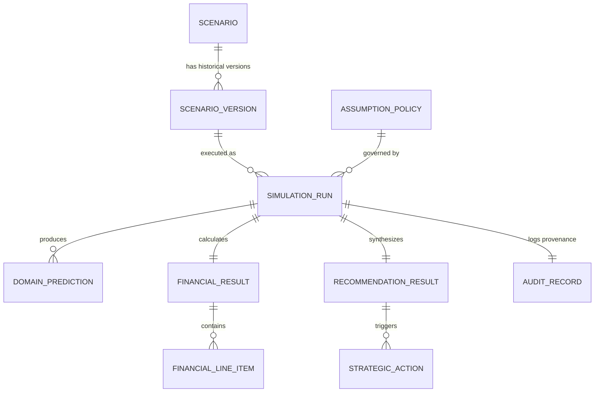

# DecisionSphere — Phase 9 Final Architecture & Research Governance Gate

**Document Status:** ACCEPTED & LOCKED WORKING BASELINE  
**Date:** September 5, 2026  
**Milestone:** Pre-Phase 9 Foundation Hardening Gate (TRL 4 / Review 2)  
**Governing Authority:** DecisionSphere Engineering Protocol (AGENTS.md)

---

## 1. Final Architecture Decision

DecisionSphere adopts a **Decoupled Modular Monolith** architecture:
1. **Analytical Core (`src/`)**: Pure Python domain packages (`src/data/`, `src/models/`, `src/scenario/`, `src/business/`, `src/recommendation/`) completely isolated from web frameworks, network transports, and databases.
2. **Backend Application Layer (`backend/`)**: A high-performance FastAPI service running on Python 3.13, orchestrating analytical calls, enforcing Pydantic v2 schemas, managing transactions, and delegating CPU-bound ML inferences to an asynchronous worker threadpool.
3. **Persistence Layer (`backend/app/db/`, PostgreSQL 16)**: Relational storage for versioned scenarios, assumption policies, simulation run histories, and audit records.
4. **Presentation Layer (`frontend/`)**: React 18/19 + TypeScript + Vite single-page application built strictly as an executive decision-support interface.
5. **Zero Microservices / Zero Message Brokers**: No Kafka, RabbitMQ, Celery, Redis, or Kubernetes clusters.
6. **Zero In-Handler ML Retraining**: ML models remain offline serialized artifacts (`.joblib`) loaded read-only into memory at service startup and cryptographically verified via SHA-256 byte hashes.

---

## 2. Research Contract

### 2.1 Research Problem
Modern enterprises operate in highly interdependent environments where commercial marketing campaigns, logistics fulfillment operations, and human workforce capacities directly impact one another. However, operational predictive models remain siloed in distinct functional units. Strategic decision-makers lack an integrated, auditable decision-support architecture capable of simulating the cascading multi-domain ripple effects of hypothetical business scenarios before real-world operational and capital commitments are made.

### 2.2 Core Novelty Statement
> **Core Novelty:**  
> *"An auditable multi-domain decision-support architecture coupling empirical predictive models with explicit propagation assumptions, deterministic managerial accounting, an independent operational Composite Risk Score, and lexicographic multi-objective decision gating."*

### 2.3 Explicit Non-Novelty Demarcations
Novelty is **NOT** claimed for:
- XGBoost, Logistic Regression, or Scikit-learn algorithms.
- FastAPI, Starlette, Uvicorn, or RESTful API patterns.
- React, TypeScript, Vite, or web charting libraries.
- PostgreSQL, SQLAlchemy, or Alembic migrations.
- Docker or containerization.
- Standard SHAP (TreeSHAP) algorithms.
- Standard CRUD database architectures.

### 2.4 Eight Pillars of Research Contribution
1. **Cross-Domain Coupling:** Methodological integration of disparate predictive models (Retail Demand, Supply Chain Delivery Risk, Workforce Attrition) through explicit operational normalization parameters (`ASM-006` to `ASM-008`).
2. **Explicit Epistemic Separation:** A 6-tier classification preventing statistical inferences and operational assumptions from being conflated with empirical ground truth.
3. **Centralized Assumption Registry:** A governed, versioned catalog (`ASM-001` to `ASM-010`) establishing transparent operational coupling constants.
4. **Deterministic Accounting:** Grounded financial accounting formulas (Option B COGS on realized revenue, non-overlapping penalty calculations) eliminating numerical hallucination.
5. **Risk-Profit Decoupling:** Complete separation of economic return ($\Delta \text{Profit}$) from operational execution strain ($\text{CRS} \in [0, 100]$).
6. **Lexicographic Decision Gating:** A prioritized multi-objective rule rejecting profit-destroying scenarios unconditionally while gating risky accretive scenarios behind required mitigations.
7. **Sensitivity & Invariance Analysis:** Formal mapping of recommendation invariance boundaries and discrete decision flip points ($\theta^*$).
8. **End-to-End Auditability & Provenance:** Bitwise-verifiable cryptographic execution signatures linking raw scenario levers to generated strategic recommendations.

### 2.5 Strict Anti-Causality Rule
In accordance with foundational scientific epistemology (Shmueli 2010):
- Statistical models compute **conditional probabilities** ($P(Y \mid X)$) or **conditional expectations** ($\mathbb{E}[Y \mid X]$), not physical or economic causation.
- Parameter shifts in scenarios represent **parameterized operational assumptions**, not verified natural experiments.
- SHAP values represent **local statistical feature attributions**, not causal mechanisms.
- All documentation, API responses, and UI elements must use non-causal language: *"Under the declared scenario assumptions, the model-implied net profit shift is calculated as..."* (never *"high demand caused a profit reduction"*).

---

## 3. Business-Question Contract

The platform is designed around five primary business decision areas:

```
Business Question 
  → Scenario Lever(s) 
  → Analytical Outputs 
  → Accounting Outputs 
  → Risk Outputs 
  → Triggered Rules 
  → Recommendation 
  → Executive Decision
```

### Area 1: Commercial Feasibility
- **Business Question:** Does the proposed commercial campaign generate genuine bottom-line profit, or does it erode operating margins through fulfillment disruption and labor overhead?
- **Scenario Levers:** `demand_growth_pct` ($[-50\%, +100\%]$), `promo_active` (`True/False`), `unit_price` (`USD`).
- **Analytical Outputs:** Baseline sales $Y_{\text{base}}$, Scenario sales $Y_{\text{scen}}$, Sales uplift $\Delta Y$.
- **Accounting Outputs:** Gross Revenue Delta ($\Delta \text{GrossRev}$), Realized Revenue Delta ($\Delta \text{RealizedRev}$), Realized COGS ($\Delta \text{Cost}_{\text{cogs}}$), Net Incremental Profit ($\Delta \text{Profit}$).
- **Risk Outputs:** Demand Surge Strain ($S_{\text{demand}} \in [0, 100]$).
- **Triggered Rules:** `RULE-04` (Margin Erosion Warning: $\Delta \text{RealizedRev} > 0$ and $\Delta \text{Profit} < 0$).
- **Recommendation:** Restructure campaign pricing, scale back promotional discount, or adjust sales targets.
- **Executive Decision:** `PROCEED` vs `REJECT_RESTRUCTURE`.

### Area 2: Logistical Capacity
- **Business Question:** Can fulfillment logistics absorb promotional order volume without triggering catastrophic carrier delivery delays and delay penalties?
- **Scenario Levers:** `scheduled_days_offset` ($[-3, +3]$ days), `shipping_mode_override` (`Standard Class`, `Second Class`, `First Class`, `Same Day`).
- **Analytical Outputs:** Predicted Late Delivery Probability $\bar{P}(\text{Late})_{\text{scen}}$, Delta Late Risk $\Delta \bar{P}(\text{Late})$.
- **Accounting Outputs:** Contractual Late Delivery Penalty ($\text{Cost}_{\text{delay}}$), Expedited Freight Surcharge ($\text{Cost}_{\text{expedite}}$).
- **Risk Outputs:** Supply Chain Strain ($S_{\text{supply}} \in [0, 100]$).
- **Triggered Rules:** `RULE-01` (High Delivery Delay Risk: $\bar{P}(\text{Late}) \ge 0.65$ or $\Delta \bar{P} \ge 0.15$), `RULE-07` (Carrier Expedited Air Freight Mandate).
- **Recommendation:** Upgrade carrier service levels, negotiate dispatch SLAs, or shift volume to First Class air freight.
- **Executive Decision:** Required Mitigation on Logistical Dispatch.

### Area 3: Inventory Resilience
- **Business Question:** Will carrier delivery delays trigger unacceptable stockout order cancellations and permanent customer churn?
- **Scenario Levers:** `ASM-003` (Cancellation factor $\kappa_{\text{stockout}} = 0.15$).
- **Analytical Outputs:** Implied Fulfillment Loss Rate $L_{\text{fulfillment}} = \min(1.0, \bar{P}(\text{Late}) \times \kappa_{\text{stockout}})$.
- **Accounting Outputs:** Revenue Loss from Churn ($\text{GrossRev} \times L_{\text{fulfillment}}$).
- **Risk Outputs:** Fulfillment Strain component in $S_{\text{supply}}$.
- **Triggered Rules:** `RULE-02` (Excessive Fulfillment Loss: $L_{\text{fulfillment}} \ge 10\%$).
- **Recommendation:** Inject buffer inventory, increase safety stock by $25\%$, and prioritize high-margin SKU shipments.
- **Executive Decision:** Required Inventory Allocation Mitigation.

### Area 4: Workforce Sustainability
- **Business Question:** Will mandatory operational overtime drive employee burnout and turnover to unsustainable levels?
- **Scenario Levers:** `overtime_workforce_pct` ($[0\%, 100\%]$), `salary_hike_override` ($[0\%, 20\%]$).
- **Analytical Outputs:** Predicted Workforce Attrition Probability $\bar{P}(\text{Attrition})_{\text{scen}}$, Attrition Shift $\Delta \bar{P}(\text{Att})$.
- **Accounting Outputs:** Overtime Labor Wages ($\text{Cost}_{\text{overtime}}$), Employee Turnover Replacement Costs ($\text{Cost}_{\text{turnover}}$).
- **Risk Outputs:** Workforce Strain ($S_{\text{workforce}} \in [0, 100]$).
- **Triggered Rules:** `RULE-03` (Severe Workforce Attrition: $\bar{P}(\text{Att}) \ge 0.21$ and $\%_{\text{ot}} \ge 30\%$), `RULE-05` (Mandatory Overtime Cap & Shift Redistribution).
- **Recommendation:** Cap mandatory overtime at 20 hours/month, deploy temporary contract staffing, or introduce retention bonuses.
- **Executive Decision:** Required Operational Labor Mitigation.

### Area 5: Executive Governance
- **Business Question:** What is the comprehensive multi-domain risk-return profile of the proposed strategic scenario?
- **Scenario Levers:** Full scenario vector + active `AssumptionPolicy`.
- **Analytical Outputs:** Net Incremental Profit ($\Delta \text{Profit}$), Composite Risk Score ($\text{CRS} \in [0, 100]$), Categorical Risk Level (`LOW`, `MEDIUM`, `HIGH`, `CRITICAL`).
- **Accounting Outputs:** Full financial line-item accounting statement.
- **Risk Outputs:** Unified Composite Risk Score $\text{CRS} = 0.40 S_s + 0.40 S_w + 0.20 S_d$.
- **Triggered Rules:** `RULE-06` (Excessive Operational Strain: $\text{CRS} > 50.0$).
- **Recommendation:** Comprehensive action plan with prioritized, severity-ranked mitigations.
- **Executive Decision:** Lexicographic Gate:
  - $\Delta \text{Profit} \le 0.0 \implies \mathbf{REJECT\_RESTRUCTURE}$
  - $\Delta \text{Profit} > 0.0 \land \text{CRS} \le 50.0 \implies \mathbf{PROCEED}$
  - $\Delta \text{Profit} > 0.0 \land \text{CRS} > 50.0 \implies \mathbf{PROCEED\_WITH\_MITIGATIONS}$

---

## 4. Epistemic Hierarchy

The system enforces a strict 6-tier classification across all data structures, APIs, and UI components:

```
[1. OBSERVED]   Historical ground-truth facts extracted from benchmark datasets.
      ↓
[2. PREDICTED]  Statistical conditional inferences P(Y|X) output by ML models.
      ↓
[3. ASSUMED]    User-defined scenario levers and centralized corporate policy constants.
      ↓
[4. PROPAGATED] Algorithmic cross-domain operational shifts across feature vectors.
      ↓
[5. CALCULATED] Deterministic managerial accounting equations (revenue, costs, profit, CRS).
      ↓
[6. RECOMMENDED] Evidence-grounded strategic actions synthesized by deterministic rules.
```

### UI & API Visual Contract
- Every API DTO and database record must include an `epistemic_tier` tag.
- The UI must visually badge every displayed metric with its epistemic tier.
- An `ASSUMED` or `PROPAGATED` value must **never** be styled or rendered as an empirical fact or guaranteed causal prediction.

---

## 5. Assumption Registry Governance

The 10 core operational parameters plus 2 financial constants are governed as first-class, versioned entities:

| ID | Name | Baseline | Sensitivity Range | Unit | Affected Phase | Epistemic Status | Mutability |
|---|---|---|---|---|---|---|---|
| **`ASM-001`** | Late Delivery Penalty Rate | $\$25.00$ | $[\$10.00, \$60.00]$ | `USD/order` | Phase 7 (`src/business/`) | Corporate Policy | Policy Versioned |
| **`ASM-002`** | Expedited Freight Surcharge | $\$15.00$ | $[\$5.00, \$35.00]$ | `USD/order` | Phase 7 (`src/business/`) | Corporate Policy | Policy Versioned |
| **`ASM-003`** | Stockout Churn Factor | $0.15$ | $[0.05, 0.40]$ | `ratio` | Phase 7 (`src/business/`) | Commercial Heuristic | Policy Versioned |
| **`ASM-004`** | Turnover Replacement Cost | $\$30,000$ | $[\$15,000, \$60,000]$ | `USD/departure` | Phase 7 (`src/business/`) | HR Benchmark | Policy Versioned |
| **`ASM-005`** | Overtime Hourly Wage Rate | $\$45.00$ | $[\$30.00, \$75.00]$ | `USD/hour` | Phase 7 (`src/business/`) | Labor Agreement | Policy Versioned |
| **`ASM-006`** | Overtime Satisfaction Impact | $-1\text{ level}$ | $\{0, -1, -2\}$ | `ordinal level` | Phase 6 (`src/scenario/`) | Behavioral Heuristic | Methodological Invariant |
| **`ASM-007`** | Retail to Warehouse Scaling | $1.00$ | $[0.50, 2.00]$ | `orders/unit` | Phase 6 (`src/scenario/`) | Operational Bridge | Scenario/Policy |
| **`ASM-008`** | Planning Cycle Synchronization | $30\text{ days}$ | $[14, 90\text{ days}]$ | `days` | Phase 6 (`src/scenario/`) | Operational Horizon | Scenario/Policy |
| **`ASM-009`** | CRS Domain Simplex Weights | $(0.4, 0.4, 0.2)$ | $\sum w_i = 1.0, w_i \ge 0$ | `simplex` | Phase 8 (`src/recommendation/`)| Executive Governance | Policy Versioned |
| **`ASM-010`** | Operational Risk Tolerance ($\tau_{\text{risk}}$)| $50.0 / 100$| $[30.0, 70.0]$ | `index score` | Phase 8 (`src/recommendation/`)| Executive Governance | Policy Versioned |
| **`cogs_ratio`** | Cost of Goods Sold Ratio | $0.60$ | $[0.30, 0.90]$ | `ratio` | Phase 7 (`src/business/`) | Financial Benchmark | Policy Versioned |
| **`unit_price`** | Retail Unit Selling Price | $\$1.00$ | $[\$0.50, \$50.00]$ | `USD/unit` | Phase 7 (`src/business/`) | Scenario Parameter | Scenario Lever |

### Governance Rule
A simulation run **never** queries mutable "current" configuration. Every run binds to an immutable `PolicyVersion` row. Updating a policy parameter creates a new `PolicyVersion` record with an incremented version number.

---

## 6. Provenance Contract

DecisionSphere distinguishes between **bitwise numerical identity** and **reproducible execution provenance**:
- *Bitwise Identity:* Bounded by floating-point hardware variations across heterogeneous CPU architectures (x86_64 vs ARM64) and BLAS/LAPACK implementations.
- *Reproducible Execution Provenance:* Exact mathematical and programmatic reproducibility of model inferences, accounting line items, discrete risk tiers, and strategic recommendations within a controlled runtime environment.

### The Provenance Signature Tuple
Every simulation run records an immutable cryptographic tuple:

$$\Sigma_{\text{run}} = \left\langle \text{ScenarioVerID}, \text{ArtifactHashes}, \text{PolicyVerID}, \text{GitCommitHash}, \text{AppVersion}, \text{PythonVersion}, \text{MigrationRevision}, \text{Timestamp} \right\rangle$$

- `ScenarioVerID`: UUID of the immutable scenario version row.
- `ArtifactHashes`: Dictionary of SHA-256 byte hashes for all three model files.
- `PolicyVerID`: UUID of the immutable assumption policy row.
- `GitCommitHash`: Full 40-character Git SHA of the executing code commit.
- `AppVersion`: Semantic version string (e.g. `1.0.0-phase9`).
- `PythonVersion`: Runtime string (e.g. `3.13.5`).
- `MigrationRevision`: Current Alembic database revision hash.
- `Timestamp`: ISO 8601 UTC timestamp of execution.

---

## 7. Database / Entity Model



### Entity Schema Specifications

1. **`scenarios` (Mutable Entity)**
   - `id`: UUID (Primary Key)
   - `name`: VARCHAR(100), NOT NULL
   - `description`: TEXT, NULLABLE
   - `is_archived`: BOOLEAN, DEFAULT FALSE
   - `created_at`, `updated_at`: TIMESTAMPTZ, NOT NULL

2. **`scenario_versions` (Immutable Entity)**
   - `id`: UUID (Primary Key)
   - `scenario_id`: UUID (Foreign Key $\rightarrow$ `scenarios.id`, ON DELETE CASCADE), INDEXED
   - `version_number`: INTEGER, NOT NULL
   - `demand_growth_pct`: FLOAT, NOT NULL (default 0.0)
   - `promo_active`: BOOLEAN, NOT NULL (default False)
   - `scheduled_days_offset`: INTEGER, NOT NULL (default 0)
   - `shipping_mode_override`: VARCHAR(50), NULLABLE
   - `overtime_workforce_pct`: FLOAT, NOT NULL (default 0.0)
   - `salary_hike_override`: FLOAT, NOT NULL (default 0.0)
   - `unit_price`: FLOAT, NOT NULL (default 1.0)
   - `created_at`: TIMESTAMPTZ, NOT NULL
   - *Constraint:* UNIQUE (`scenario_id`, `version_number`)

3. **`assumption_policies` (Immutable Entity)**
   - `id`: UUID (Primary Key)
   - `version_number`: INTEGER, NOT NULL, UNIQUE
   - `late_penalty_rate`: FLOAT, NOT NULL (ASM-001)
   - `expedite_fee`: FLOAT, NOT NULL (ASM-002)
   - `stockout_churn_factor`: FLOAT, NOT NULL (ASM-003)
   - `replacement_cost`: FLOAT, NOT NULL (ASM-004)
   - `overtime_wage_rate`: FLOAT, NOT NULL (ASM-005)
   - `order_scaling_factor`: FLOAT, NOT NULL (ASM-007)
   - `planning_cycle_days`: INTEGER, NOT NULL (ASM-008)
   - `crs_w_supply`: FLOAT, NOT NULL (ASM-009)
   - `crs_w_workforce`: FLOAT, NOT NULL (ASM-009)
   - `crs_w_demand`: FLOAT, NOT NULL (ASM-009)
   - `tau_risk`: FLOAT, NOT NULL (ASM-010)
   - `cogs_ratio`: FLOAT, NOT NULL
   - `created_at`: TIMESTAMPTZ, NOT NULL

4. **`simulation_runs` (Immutable Entity)**
   - `id`: UUID (Primary Key)
   - `scenario_version_id`: UUID (Foreign Key $\rightarrow$ `scenario_versions.id`), INDEXED
   - `policy_id`: UUID (Foreign Key $\rightarrow$ `assumption_policies.id`), INDEXED
   - `execution_status`: VARCHAR(20), NOT NULL (`SUCCESS`, `FAILED`)
   - `execution_duration_ms`: FLOAT, NOT NULL
   - `executed_at`: TIMESTAMPTZ, NOT NULL, INDEXED

5. **`domain_predictions` (Immutable Entity)**
   - `id`: UUID (Primary Key)
   - `simulation_run_id`: UUID (Foreign Key $\rightarrow$ `simulation_runs.id`, ON DELETE CASCADE), INDEXED
   - `domain`: VARCHAR(30), NOT NULL (`DEMAND`, `SUPPLY_CHAIN`, `WORKFORCE`)
   - `metric_name`: VARCHAR(50), NOT NULL
   - `baseline_value`: FLOAT, NOT NULL
   - `scenario_value`: FLOAT, NOT NULL
   - `delta_value`: FLOAT, NOT NULL
   - `epistemic_tier`: VARCHAR(20), NOT NULL (`PREDICTED`)

6. **`financial_results` & `financial_line_items` (Immutable Entities)**
   - Normalized line items: `gross_revenue`, `fulfillment_loss_cost`, `realized_revenue`, `cogs`, `supply_delay_cost`, `expedite_cost`, `turnover_cost`, `overtime_cost`, `net_profit_delta`.
   - All monetary figures stored with `numeric_precision` = 2.

7. **`recommendation_results` & `strategic_actions` (Immutable Entities)**
   - `decision_category`: VARCHAR(30), NOT NULL (`PROCEED`, `PROCEED_WITH_MITIGATIONS`, `REJECT_RESTRUCTURE`)
   - `composite_risk_score`: FLOAT, NOT NULL ($[0, 100]$)
   - `risk_level`: VARCHAR(20), NOT NULL
   - Normalized `strategic_actions`: `action_id`, `domain`, `severity`, `title`, `description`, `trigger_rule_id`, `expected_trade_off`.

8. **`audit_records` (Immutable Append-Only Entity)**
   - `id`: UUID (Primary Key)
   - `simulation_run_id`: UUID (Foreign Key $\rightarrow$ `simulation_runs.id`)
   - `provenance_json`: JSONB, NOT NULL (Stores the full $\Sigma_{\text{run}}$ tuple)
   - `created_at`: TIMESTAMPTZ, NOT NULL

---

## 8. API Contract Principles

### 8.1 Schema Enforcement
- All Request and Response payloads are strictly modeled as Pydantic v2 schemas.
- All request schemas enforce `model_config = ConfigDict(extra="forbid")` to reject unvalidated levers.
- Strict separation between **API DTOs** (`backend/app/schemas/`), **Domain Objects** (`src/*/schema.py`), and **ORM Entities** (`backend/app/models/`). ORM models are never leaked to API responses.

### 8.2 Standard HTTP Status Codes
- `200 OK`: Successful resource retrieval or sweep execution.
- `201 Created`: Successful scenario creation or simulation execution.
- `400 Bad Request`: Validation failure or unsupported parameter values.
- `404 Not Found`: Target scenario or simulation run ID does not exist.
- `422 Unprocessable Entity`: Schema validation or type mismatch error.
- `500 Internal Server Error`: Unhandled application exception.
- `503 Service Unavailable`: ML model artifact file missing or SHA-256 fingerprint mismatch.

### 8.3 Standard Error Contract
```json
{
  "error_code": "MODEL_INTEGRITY_FAILURE",
  "message": "Model artifact hash mismatch for demand_model.joblib",
  "details": {
    "expected_sha256": "fb438c03...",
    "actual_sha256": "e3b0c442..."
  },
  "request_id": "req-9f8a3c21-4d5e"
}
```

### 8.4 Request Correlation
Every incoming HTTP request receives an `X-Request-ID` header (generated if absent), propagated through all structured JSON log entries.

---

## 9. Simulation Transaction Semantics

When `POST /api/v1/scenarios/{id}/run` is called:

```
1. Receive & Validate Request DTO
      │
2. Begin Database Transaction
      │
3. Resolve Scenario & Fetch/Create ScenarioVersion
      │
4. Resolve Active AssumptionPolicy Version
      │
5. Verify ML Model Artifact Existence & SHA-256 Hashes
      │   (If mismatch: Rollback -> Raise HTTP 503)
      │
6. Delegate Execution to Threadpool:
      │   - Phase 6 ScenarioEngine.execute()
      │   - Phase 7 BusinessImpactEngine.calculate()
      │   - Phase 8 RecommendationEngine.evaluate()
      │
7. In Case of Analytical Failure:
      │   Rollback Transaction -> Return HTTP 400/500
      │
8. Persist Simulation Entities:
      │   - Insert simulation_runs
      │   - Insert domain_predictions
      │   - Insert financial_results & line_items
      │   - Insert recommendation_results & strategic_actions
      │   - Insert audit_records (Provenance Tuple)
      │
9. Commit Database Transaction
      │
10. Return Immutable SimulationResponse (201 Created)
```

**Transaction Atomicity Guarantee:** No partially committed simulation runs are ever created in PostgreSQL. If any step fails, the entire transaction is rolled back.

---

## 10. Concurrency & Execution Strategy

- **Modular Monolith Concurrency:** FastAPI runs on `uvicorn`. Since simulation runs in `src/` are CPU-intensive NumPy/XGBoost operations, they are offloaded to AnyIO worker threads:
  ```python
  from starlette.concurrency import run_in_threadpool
  result = await run_in_threadpool(orchestrator.run_simulation, params, policy)
  ```
- **Thread Safety of Model Objects:** Pre-loaded Scikit-learn and XGBoost model objects are treated as strictly **read-only** (`predict()` and `predict_proba()` do not mutate internal model weights), ensuring complete thread safety across concurrent requests.
- **Reference Cohort Memory Footprint:** Reference baseline datasets (DataCo sample orders, IBM HR employee roster) are loaded into application memory once at startup as immutable reference frames. Invocations deep-copy only the necessary lightweight cohort slices ($< 10\text{ MB}$), avoiding repeated disk I/O without incurring memory leaks.
- **Concurrency Ceiling:** Threadpool concurrency defaults to $N_{\text{workers}} = \min(32, \text{os.cpu\_count}() + 4)$, ensuring high throughput for classroom/evaluation demonstrations without crashing memory.

---

## 11. Security & Configuration Strategy

- **Configuration via Environment:** Managed strictly via `pydantic-settings` (`backend/app/core/config.py`).
- **Zero Secrets in Git:** Database connection strings, API keys, and environment toggles are injected via `.env` files (with `.env.example` committed).
- **Environment Profiles:** Explicitly partitioned profiles: `development`, `testing`, `production`.
- **SQL Injection Elimination:** 100% parameterized queries through SQLAlchemy 2.0 ORM expressions.
- **CORS Governance:** Explicit whitelist restricting origins to `http://localhost:3000` and `http://127.0.0.1:3000`.
- **Authentication Boundary:** For Review 2 / academic evaluation, a clean API key header dependency (`X-API-Key`) is implemented, allowing simple local access while establishing a secure plug-in point for JWT/OAuth2 if enterprise deployment is required later.

---

## 12. Docker Deployment Strategy

A production-quality **3-container stack** orchestrated via `docker-compose.yml`:

1. **`postgres` Container:**
   - Image: `postgres:16-alpine`
   - Named volume: `decision_pgdata:/var/lib/postgresql/data`
   - Healthcheck: `pg_isready -U decisionsphere`
2. **`backend` Container:**
   - Multi-stage build based on `python:3.13-slim`
   - Non-root user: `appuser:10001`
   - Mounts model directory read-only
   - Healthcheck: `curl -f http://localhost:8000/api/v1/health`
   - Startup command: runs `alembic upgrade head` before launching `uvicorn`
3. **`frontend` Container:**
   - Multi-stage build: Node 20 build stage $\rightarrow$ Nginx Alpine static serving
   - Configured with SPA fallback routing (`try_files $uri $uri/ /index.html`)
   - Internal proxy pass `/api/` to backend container

---

## 13. Frontend UX Contract

The frontend is designed around **Executive Decision Support**, completely avoiding generic database CRUD layouts:

```
[Dashboard] 
   → Select / Create Scenario 
   → Adjust Levers (Sliders with Live Preview) 
   → Run Multi-Domain Simulation 
   → Executive Decision Banner (PROCEED / MITIGATE / REJECT) 
   → Financial Waterfall & Net Profit Delta 
   → Composite Risk Score & Domain Radar 
   → Prioritized Strategic Action Cards 
   → Sensitivity Flip-Point Explorer 
   → Epistemic Lineage & Audit Trail
```

### Eight Mandatory Core Visualizations
1. **Executive Decision Banner:** High-contrast, unambiguous decision badge (`PROCEED`, `PROCEED_WITH_MITIGATIONS`, `REJECT_RESTRUCTURE`) with summary rationale.
2. **Profit / Loss Delta Hero:** Callout metric displaying Net Incremental Profit ($\Delta \text{Profit}$) with green/red directional indicators.
3. **Financial Accounting Waterfall:** Interactive waterfall chart decomposing $\text{Gross Revenue} \rightarrow -\text{Churn} \rightarrow -\text{COGS} \rightarrow -\text{Delay Penalties} \rightarrow -\text{Labor Overhead} \rightarrow \Delta \text{Profit}$.
4. **Composite Risk Gauge:** Radial index gauge $[0, 100]$ displaying aggregate operational strain relative to the $50.0$ threshold.
5. **Domain Risk Breakdown:** Comparative bar/radar chart comparing $S_{\text{supply}}$, $S_{\text{workforce}}$, and $S_{\text{demand}}$.
6. **Prioritized Action Cards:** Mitigation directives sorted by severity (`CRITICAL`, `HIGH`, `MEDIUM`, `LOW`), citing specific quantitative triggers and trade-off statements.
7. **Sensitivity Flip-Point Explorer:** Interactive response curves illustrating how $\Delta \text{Profit}$ and $\text{CRS}$ cross decision boundaries as coupling parameters vary.
8. **Audit / Epistemic Trace Modal:** Field-level inspection view showing formulas, inputs, and epistemic tiers for any displayed metric.

---

## 14. Testing Gates

No Phase 9 code is approved or merged unless all eleven testing gates pass:

- **Gate A (Analytical Invariance):** All 93 existing tests in `tests/` pass with 100% success.
- **Gate B (Model Fingerprint Invariance):** SHA-256 byte hashes of all three `.joblib` files match exact frozen signatures.
- **Gate C (Migration Idempotency):** `alembic upgrade head` $\rightarrow$ `alembic downgrade base` $\rightarrow$ `alembic upgrade head` executes with zero errors.
- **Gate D (Database Constraints):** Automated tests verify unique constraints, foreign key cascades, and check constraints.
- **Gate E (API Schema Validation):** Automated tests verify `extra="forbid"` rejects rogue payload attributes and enforces boundary limits.
- **Gate F (Transaction Atomicity):** Simulated mid-run exceptions verify that failed runs leave zero orphaned database records.
- **Gate G (Version Immutability):** Automated tests confirm that modifying scenario levers generates a new `ScenarioVersion` without mutating past versions.
- **Gate H (Provenance Tuple Generation):** Automated test verifies all 8 fields of $\Sigma_{\text{run}}$ are persisted and valid.
- **Gate I (Model Integrity Failure):** Simulated corrupt model file triggers HTTP 503 Service Unavailable with proper error payload.
- **Gate J (End-to-End Simulation):** Complete lifecycle test: Create Scenario $\rightarrow$ Run Simulation $\rightarrow$ Fetch Results $\rightarrow$ Verify Financials & Recommendations.
- **Gate K (Frontend Interaction Tests):** Slider debouncing and schema validation tests pass under Vitest.

---

## 15. Research Integrity & Open Issues

This section explicitly documents methodological limitations and flags research issues rather than concealing them:

### Issue 1: Falsification Criterion for Hypothesis $H_1$ (Decision Divergence)
- *Previous Proposal:* Falsified if $\Delta \text{Profit}$ perfectly correlates with $\Delta \text{Revenue}$ ($r > 0.98$).
- *Critical Review:* Pearson's $r$ measures linear association, not decision classification divergence. A company can have high revenue growth perfectly correlated with nominal profit while simultaneously facing an operational crisis ($\text{CRS} > 50.0$) that changes the decision from `PROCEED` to `PROCEED_WITH_MITIGATIONS`.
- *Refinement:* Measure the **Categorical Decision Divergence Rate (DDR)**:
  $$\text{DDR} = \frac{1}{N} \sum_{i=1}^N \mathbb{I}\left(\text{Decision}_{\text{integrated}}(i) \neq \text{Decision}_{\text{isolated}}(i)\right)$$
  where $\text{Decision}_{\text{isolated}}$ considers only commercial growth ($\Delta \text{Revenue} > 0 \implies \text{PROCEED}$). $H_1$ is supported if $\text{DDR} \ge 20\%$ in high-shock scenarios ($\Delta D \ge +30\%$).

### Issue 2: Response Surface Convexity for Hypothesis $H_2$ (Profit Inversion Point)
- *Previous Proposal:* Assumed an inverted-U dynamic $\frac{\partial (\Delta \text{Profit})}{\partial (\Delta D)}$ exists across all parameter configurations.
- *Critical Review:* In our managerial accounting formulation, gross margin is linear in sales ($0.40 \times \$1.00 \times \Delta Y$). Supply chain delay penalties scale with late probability $\bar{P}(\text{Late}) \le 1.0$, and workforce overtime costs scale with workforce headcount $N_{\text{workforce}}$. Because order scaling is $1.0$ order per sales unit and delay penalty is $\$25.00$ per delayed order, high late delivery probabilities incur massive penalties that can overwhelm margins. However, if late probability saturates near $1.0$, marginal disruption cost levels off while marginal revenue continues growing.
- *Refinement:* Whether an inverted-U exists depends on the ratio of unit margin to penalty costs. We treat the existence of $\Delta D^*$ as an **empirical research inquiry** to be mapped via Experiment B sweeps rather than an assumed theoretical certainty.

### Issue 3: Robustness Window for Hypothesis $H_3$ (Parameter Invariance)
- *Previous Proposal:* Stated recommendations remain invariant across a $\pm 25\%$ variation around baseline values.
- *Critical Review:* The $\pm 25\%$ window was a heuristic benchmark without grounding in empirical cost variance. Furthermore, recommendation transitions occur at discrete step boundaries ($\Delta \text{Profit} = 0$, $\text{CRS} = 50.0$).
- *Refinement:* Experiment D will explicitly compute the **exact distance to the nearest decision flip boundary**:
  $$\delta_{\text{boundary}} = \min_{\theta \in \Theta} \left| \theta_{\text{current}} - \theta_{\text{flip}} \right|$$
  This reports the precise tolerance margin (in dollars or percentages) before a recommendation flips.

### Issue 4: Statistical Significance Testing for Hypothesis $H_4$ (SHAP Concordance)
- *Previous Proposal:* Proposed a $p$-value test ($p < 0.01$) for directional alignment between TreeSHAP attributions and recommendation triggers.
- *Critical Review:* TreeSHAP values calculated on synthetic scenario cohorts reflect the deterministic structure of the trained tree ensembles, not a random sampling distribution. Running inferential $p$-value tests on deterministic algorithmic outputs across large synthetic samples ($N > 1000$) produces trivially small $p$-values that lack statistical meaning.
- *Refinement:* Replace the $p$-value test with **Spearman's Rank Correlation Coefficient ($\rho$)** and **Directional Agreement Ratio (DAR)**:
  $$\text{DAR} = \frac{1}{M} \sum_{j=1}^M \mathbb{I}\left(\operatorname{sgn}(\Delta \text{Lever}_j) = \operatorname{sgn}(\Delta \overline{\text{SHAP}}_j)\right)$$
  $H_4$ is supported if $\text{DAR} \ge 85\%$ across perturbed scenario features.

### Issue 5: Epistemic Status of Cross-Domain Benchmark Datasets
- *Open Reality:* Rossmann (European retail sales, 2013–2015), DataCo (Global supply chain logistics, 2015–2018), and IBM HR (Synthetic corporate attrition survey) originate from different organizations and time periods.
- *Scientific Defensibility:* DecisionSphere does **not** claim that these datasets represent a single historical enterprise. Instead, they serve as a **Normalized Synthetic Coupling Testbed** demonstrating the mathematical and computational viability of multi-domain scenario decision support.

---

## 16. Architecture Decision Records (ADR) Index

| ADR ID | Title | Status | Primary Rationale |
|---|---|---|---|
| **[ADR-001](file:///d:/Projects/DecisionSphere/docs/architecture-decisions/ADR-001-initial-architecture.md)** | Initial System Architecture and Technology Stack | ACCEPTED | Decoupled modular monolith; FastAPI + React + PostgreSQL + offline ML. |
| **[ADR-002](file:///d:/Projects/DecisionSphere/docs/architecture-decisions/ADR-002-modular-monolith-architecture.md)** | Modular Monolith Architecture over Microservices | ACCEPTED | Eliminates network latency, distributed race conditions, and cluster overhead. |
| **[ADR-003](file:///d:/Projects/DecisionSphere/docs/architecture-decisions/ADR-003-lexicographic-multi-objective-gating.md)** | Lexicographic Multi-Objective Decision Gating | ACCEPTED | Prioritizes capital preservation ($\Delta \text{Profit} > 0$) before evaluating operational strain ($\text{CRS} \le 50.0$). |
| **[ADR-004](file:///d:/Projects/DecisionSphere/docs/architecture-decisions/ADR-004-versioned-scenario-policy-provenance.md)** | Versioned Scenario and Policy Provenance | ACCEPTED | Enforces immutable versioned snapshots for bitwise auditability and historical reproducibility. |
| **[ADR-005](file:///d:/Projects/DecisionSphere/docs/architecture-decisions/ADR-005-persistence-boundary-and-system-of-record.md)** | Persistence Boundary and System of Record | ACCEPTED | PostgreSQL stores business records; filesystem stores ML models; RAM stores reference baselines. |
| **[ADR-006](file:///d:/Projects/DecisionSphere/docs/architecture-decisions/ADR-006-cpu-bound-synchronous-execution-strategy.md)** | Synchronous CPU-Bound ML Execution Strategy | ACCEPTED | Offloads CPU-intensive inference to Starlette threadpools to keep FastAPI event loop unblocked. |

---

## 17. Phase 9 Implementation Sequence

Phase 9 will be executed in small, testable milestones:

```
[Milestone 9.0] Foundation & Environment Hardening
      │ - Install backend packages (fastapi, uvicorn, sqlalchemy, alembic, pydantic-settings)
      │ - Configure backend/app/core/config.py, logging.py, errors.py
      │ - Test: verify environment imports, path anchors, and logging
      ▼
[Milestone 9.1] Database Engine & SQLAlchemy 2.0 Models
      │ - Implement backend/app/db/session.py, base.py
      │ - Implement ORM entities in backend/app/models/
      │ - Test: verify model relationships and constraint definitions
      ▼
[Milestone 9.2] Alembic Migrations Setup
      │ - Initialize alembic environment and configure env.py
      │ - Generate initial schema migration (001_initial_schema.py)
      │ - Test Gate C: verify upgrade head -> downgrade base -> upgrade head
      ▼
[Milestone 9.3] Application Services Layer
      │ - Implement backend/app/services/simulation_orchestrator.py
      │ - Implement backend/app/services/sensitivity_service.py
      │ - Implement backend/app/services/policy_service.py
      │ - Test: verify threadpool offloading and analytical wrapping
      ▼
[Milestone 9.4] Pydantic v2 Schemas & API DTOs
      │ - Implement backend/app/schemas/ (Scenario, Simulation, Policy, Health)
      │ - Enforce extra="forbid" and validation boundaries
      │ - Test Gate E: verify validation rejections
      ▼
[Milestone 9.5] FastAPI Route Controllers & API Router
      │ - Implement endpoints under backend/app/api/v1/endpoints/
      │ - Assemble unified api_router.py and instantiate backend/app/main.py
      │ - Test: verify route registration and CORS headers
      ▼
[Milestone 9.6] Backend Automated Test Suite
      │ - Implement integration test suite in backend/tests/ using httpx.AsyncClient
      │ - Verify Gates D, E, F, G, H, I, J
      │ - Maintain 100% regression pass (93 core tests + backend tests)
      ▼
[Milestone 9.7] Docker & Docker Compose Setup
      │ - Create backend/Dockerfile (multi-stage, non-root)
      │ - Create docker-compose.yml (frontend, backend, postgres)
      │ - Test: verify container spin-up and healthcheck probes
```

---

**FOUNDATION HARDENING GATE COMPLETE. READY FOR PHASE 9: MILESTONE 9.0.**
