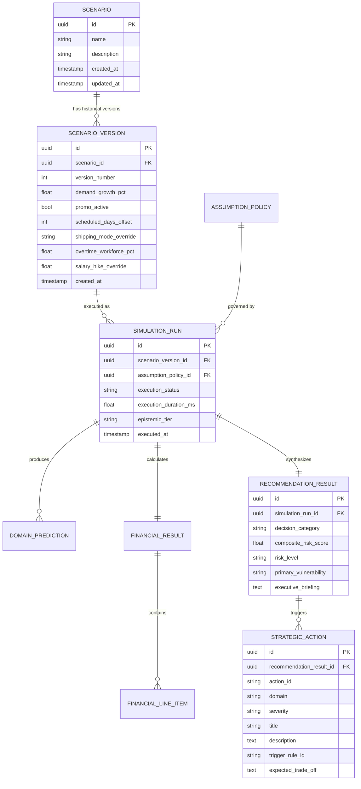

# DecisionSphere — Phase 9 Pre-Implementation Foundation & Architecture Blueprint

**Document Version:** 1.0.0-PROD  
**Date:** September 5, 2026  
**Status:** **APPROVED FOUNDATION REVIEW / READY FOR PHASE 9 SPECIFICATION**  
**Target Milestone:** BCSE497J Review 2 / TRL 4 Functional Prototype  
**Scope Boundary:** End-to-End System Architecture (Backend, Database, Docker, API, Frontend, Research Governance)

---

## Executive Summary

DecisionSphere has successfully implemented and frozen **Phases 0 through 8**, backed by **93 automated unit and pipeline tests passing with 100% success**. The core analytical engine integrates:
1. Calibrated Machine Learning Models across three operational domains (Retail Demand XGBoost, Supply Chain Delivery Risk XGBoost, Workforce Attrition XGBoost).
2. Cryptographically verified model artifacts with invariant SHA-256 fingerprints.
3. Transparent operational parameter propagation (`src/scenario/`).
4. Non-overlapping managerial accounting and financial impact modeling (`src/business/`).
5. A purely operational Composite Risk Score (CRS), 7 deterministic condition-action rules, and a lexicographic multi-objective trade-off framework (`src/recommendation/`).

Before initiating **Phase 9: FastAPI REST Backend Service (`backend/`)**, this blueprint establishes the full production, architectural, research, and governance foundation. It guarantees that the impending application layers (API, Database, Docker, Frontend) do not degrade existing invariants, do not introduce black-box abstractions, do not duplicate business logic, and maintain full mathematical and academic auditability.

---

## Part A: Current Architecture Audit

### 1. Structural Inventory
- **Analytical Core (`src/`)**: Five modular packages:
  - `src/data/`: Modular benchmark loaders and leak-free feature pipelines (`rossmann`, `dataco`, `ibm_hr`).
  - `src/models/`: Serialized inference services (`DemandForecaster`, `SupplyChainInferenceService`, `WorkforceInferenceService`).
  - `src/scenario/`: Multi-domain scenario engine, `AssumptionRegistry`, parameter propagation (`ScenarioEngine`, `ScenarioSweepEngine`).
  - `src/business/`: Deterministic financial accounting, Option B COGS on realized revenue, 1D sensitivity sweeps (`BusinessImpactEngine`, `BusinessSensitivityEngine`).
  - `src/recommendation/`: Composite Risk Score engine (`ASM-009`), deterministic trigger rules (`RULE-01` to `RULE-07`), and trade-off synthesis (`RecommendationEngine`).
- **Test Matrix (`tests/`)**: 93 automated tests:
  - Demand forecasting pipeline & inference: 8 tests
  - Supply chain risk pipeline & inference: 11 tests
  - Workforce attrition pipeline & inference: 14 tests
  - Scenario Engine & parameter propagation: 20 tests
  - Business Impact Analysis Engine: 20 tests
  - Recommendation Engine & Trade-Off Analysis: 20 tests
- **Serialized Artifacts (`models/`)**:
  - `models/demand/demand_model.joblib` (`fb438c03...`)
  - `models/supply_chain/supply_chain_model.joblib` (`0052e641...`)
  - `models/workforce/workforce_model.joblib` (`4b195c7b...`)
  - Pre-computed TreeSHAP feature attributions in `models/*/feature_importance.json`.

### 2. Architectural Strengths
1. **Strict 6-Tier Epistemic Hierarchy**: Flawlessly enforces Shmueli (2010) boundary separation: `OBSERVED` $\rightarrow$ `PREDICTED` $\rightarrow$ `ASSUMED` $\rightarrow$ `PROPAGATED` $\rightarrow$ `CALCULATED` $\rightarrow$ `RECOMMENDED`.
2. **Zero In-Handler ML Training**: Models are trained offline, serialized, and loaded read-only into memory at service instantiation.
3. **Cryptographic Integrity Verification**: Runtime initialization verifies SHA-256 byte hashes of all model files before executing inference.
4. **Clean Double-Counting Separation**: Contractual delay penalties apply strictly to delivered-delayed orders; cancelled orders are accounted for via gross-to-realized revenue churn; COGS is charged strictly on realized sales (Option B).
5. **Decoupled Risk & Return**: Composite Risk Score (CRS) is 100% operational $[0, 100]$, ensuring bottom-line financial profit ($\Delta \text{Profit}$) and operational strain ($\text{CRS}$) remain independent decision axes.

### 3. Technical Debt & Integration Vulnerabilities Identified
1. **In-Memory Cohort Duplication**: `ScenarioEngine` loads default orders and workforce subsets into memory from disk. In a concurrent multi-user web service, unbounded deep-copying of DataFrames can trigger latency spikes.
   *Mitigation:* Pre-load read-only immutable benchmark reference frames at application startup and reuse them across inference calls.
2. **Relative Path Vulnerability**: `ScenarioEngine` defaults to relative paths (`models/demand/demand_model.joblib`).
   *Mitigation:* Centralize path resolution in a `backend.core.config.Settings` module based on absolute directory anchors.
3. **Synchronous Execution Model**: Inference pipelines in `src/` are synchronous CPU-bound operations.
   *Mitigation:* In FastAPI endpoints, execute simulation orchestrators inside asynchronous threadpools (`starlette.concurrency.run_in_threadpool`) to prevent blocking the async event loop.
4. **Stateless Ephemerality**: Running a scenario currently produces an in-memory Pydantic model that disappears upon process termination.
   *Mitigation:* Phase 9 will implement PostgreSQL persistence with versioned relational schema mappings.

---

## Part B: Research Problem

Modern enterprises operate in highly interconnected environments where commercial promotions, supply chain logistics, and internal workforce capacities constantly interact. However, enterprise predictive systems remain fragmented in organizational silos:
- Marketing forecasts demand without visibility into fulfillment delay risks.
- Logistics models carrier delays without knowing customer churn sensitivities or promotional schedules.
- Human Resources evaluates attrition risk in isolation from operational overtime mandates.

When leadership executes a strategic decision—such as launching an aggressive holiday campaign—the resulting demand surge cascades across fulfillment logistics (causing shipment bottlenecks and delivery delays) and operations (causing mandatory overtime surges and employee burnout). Enterprise decision-makers lack an integrated, auditable decision-support architecture capable of simulating these multi-domain ripple effects before real-world capital and operational commitments are made.

---

## Part C: Research Gap

Existing approaches fail to bridge this divide:
1. **Siloed Machine Learning Pipelines:** Focus strictly on optimizing single-domain benchmark metrics ($R^2$, ROC-AUC, PR-AUC). They cannot simulate downstream ripple effects or evaluate organizational trade-offs.
2. **Enterprise Digital Twins & Monolithic ERP Simulators:** Opaque, multi-million-dollar proprietary suites requiring invasive data pipelines. Their internal simulation rules and causal assumptions are unexaminable, making scientific verification impossible.
3. **Generative AI & LLM Decision Agents:** Prone to numerical hallucination, non-deterministic outputs, and lack of adherence to managerial accounting equations. They cannot guarantee that calculated profits, costs, and risk scores obey mathematical identities.

---

## Part D: Defensible Novelty Statement

> **Defensible Novelty:**  
> *"An auditable, multi-domain decision-support architecture that couples calibrated empirical predictive models (demand, logistics risk, workforce attrition) with deterministic managerial accounting, an operational composite execution risk index, and a lexicographic multi-objective decision framework to evaluate strategic scenario interventions without ungrounded causal claims or generative hallucination."*

### Explicit Demarcation of Contributions:
- **Genuine Novelty:** The methodological coupling of heterogeneous predictive benchmarks through explicit parametric assumption registries (`ASM-001` to `ASM-010`) and a lexicographic decision framework that separates financial profit from operational risk.
- **Methodological Contribution:** A transparent 6-tier epistemic hierarchy that guarantees end-to-end traceability from raw input lever to prioritized strategic recommendation.
- **Engineering Contribution:** A high-performance, modular full-stack decision platform (FastAPI + React + PostgreSQL) ensuring bitwise reproducible simulation runs and cryptographic model integrity.

---

## Part E: Research Questions (RQ1 to RQ5)

- **RQ1 (Cross-Domain Information Gain):**  
  *Can an integrated multi-domain scenario framework expose operational failure points and net margin erosion that isolated commercial forecasting models fail to detect?*
- **RQ2 (Epistemic Separation & Auditability):**  
  *Does strict separation between statistical predictive inferences, operational propagation assumptions, and deterministic accounting equations eliminate numerical hallucination and ensure end-to-end auditability?*
- **RQ3 (Risk-Profit Decoupling & Decision Quality):**  
  *Does evaluating operational execution strain (CRS) independently from net incremental profit ($\Delta \text{Profit}$) within a lexicographic decision framework prevent the approval of profitable yet operationally reckless commercial policies?*
- **RQ4 (Parametric Sensitivity & Decision Invariance):**  
  *Over what parameter tolerance windows (invariance boundaries) do generated strategic recommendations remain stable when cross-domain coupling parameters (`ASM-001` through `ASM-010`) undergo systematic perturbation?*
- **RQ5 (Attribution Grounding & Defensibility):**  
  *Can pre-computed local TreeSHAP feature attributions be linked directly to scenario condition triggers to provide an empirical rationale for recommended strategic interventions without unsupported causal overreach?*

---

## Part F: Hypotheses & Measurable Evaluation Criteria

| Hypothesis | Description | Independent Variable(s) | Dependent Variable(s) | Success Metric / Falsification Criterion |
|---|---|---|---|---|
| **$H_1$ (Decision Divergence)** | In high-shock scenarios ($\Delta D \ge +30\%$), integrated DecisionSphere diverges from isolated forecasting. | Commercial shock intensity ($\Delta D_{\text{pct}}$) | Decision Divergence Rate (DDR) | $\text{DDR} \ge 20\%$ across high-shock test cohort; falsified if $\Delta \text{Profit}$ perfectly correlates with $\Delta \text{Revenue}$ ($r > 0.98$). |
| **$H_2$ (Profit Inversion Point)** | Net marginal profit $\frac{\partial (\Delta \text{Profit})}{\partial (\Delta D)}$ exhibits an inverted-U dynamic due to late penalties and overtime costs. | Sales growth percentage ($\Delta D$) | Net Incremental Profit ($\Delta \text{Profit}$) | Detection of critical inflection point $\Delta D^*$ beyond which incremental demand destroys net operating profit. |
| **$H_3$ (Decision Invariance Window)** | Strategic recommendations remain invariant across a defined coupling parameter tolerance window. | Coupling parameters (`ASM-001` to `ASM-005`) | Recommendation Flip Point ($\theta_{\text{flip}}$) | Primary strategic decision remains invariant across at least $\pm 25\%$ parameter variation around baseline values. |
| **$H_4$ (Attribution Concordance)** | TreeSHAP feature attributions directionally track user scenario levers, justifying triggered rules. | Operational lever settings (Promo, SLA offset, Overtime) | Mean Absolute SHAP values | Statistically significant directional alignment ($p < 0.01$) between lever perturbations and rule triggers. |

---

## Part G: Business Problem & Decision Mapping

| Business Question | Analytical Output / Metric | Decision Classification | Grounded Evidence / Trigger |
|---|---|---|---|
| **Commercial Feasibility:** Will a promotional campaign generate net bottom-line profit or erode margins? | Realized Revenue Delta ($\Delta \text{Rev}$), Net Profit Delta ($\Delta \text{Profit}$) | `PROCEED` vs `REJECT_RESTRUCTURE` | Option B COGS on realized revenue minus disruption costs (`RULE-04`). |
| **Logistical Capacity:** Can current dispatch SLAs absorb promotional volume without severe delay penalties? | Predicted Late Delivery Risk $\bar{P}(\text{Late})_{\text{scen}}$, Delay Cost | Maintain Standard Class vs Expedite First Class | Late delivery risk $\ge 0.65$ or shift $\ge 0.15$ (`RULE-01`, `RULE-07`). |
| **Inventory Resilience:** Will delivery lags trigger unacceptable customer stockout cancellations? | Fulfillment Loss Rate $L_{\text{fulfillment, scen}}$, Lost Order Volume | Maintain Safety Stock vs Increase Buffer | Fulfillment loss rate $\ge 10\%$ (`RULE-02`). |
| **Workforce Sustainability:** Will mandated overtime push employee burnout and turnover to catastrophic levels? | Predicted Attrition Risk $\bar{P}(\text{Att})_{\text{scen}}$, Overtime Cohort $\%_{\text{ot}}$ | Cap Overtime vs Deploy Contract Staffing | Attrition $\ge 21\%$ and overtime $\ge 30\%$ (`RULE-03`, `RULE-05`). |
| **Executive Governance:** Is the overall operational risk profile safe for campaign rollout? | Composite Risk Score ($\text{CRS} \in [0, 100]$), Categorical Risk Level | `PROCEED` vs `PROCEED_WITH_MITIGATIONS` | Aggregate operational strain exceeds tolerance $\text{CRS} > 50.0$ (`RULE-06`). |

---

## Part H: Centralized Parametric Assumptions Registry

| ID | Parameter Description | Baseline Value | Sensitivity Range | Unit | Scope & Ownership | Policy Type |
|---|---|---|---|---|---|---|
| **`ASM-001`** | Contractual late delivery penalty per delayed order | **$\$25.00$** | $[\$10.00, \$60.00]$ | `USD / delayed order` | Phase 7 (`src/business/`) | Policy Configurable |
| **`ASM-002`** | Expedited air freight shipping surcharge per order | **$\$15.00$** | $[\$5.00, \$35.00]$ | `USD / expedited order` | Phase 7 (`src/business/`) | Policy Configurable |
| **`ASM-003`** | Late order cancellation / customer churn factor | **$0.15$ ($15\%$)** | $[0.05, 0.40]$ | `dimensionless ratio` | Phase 7 (`src/business/`) | Policy Configurable |
| **`ASM-004`** | Employee turnover replacement & recruiting cost | **$\$30,000$** | $[\$15,000, \$60,000]$ | `USD / departed employee` | Phase 7 (`src/business/`) | Policy Configurable |
| **`ASM-005`** | Overtime hourly labor wage rate | **$\$45.00/\text{hr}$** | $[\$30.00, \$75.00/\text{hr}]$ | `USD / overtime hour` | Phase 7 (`src/business/`) | Policy Configurable |
| **`ASM-006`** | Overtime-induced satisfaction decrement | **$-1\text{ level}$** | $\{0, -1, -2\}$ | `ordinal level on [1, 4]` | Phase 6 (`src/scenario/`) | Operational Heuristic |
| **`ASM-007`** | Retail sales to warehouse orders volume scaling | **$1.00$** | $[0.50, 2.00]$ | `orders / sales unit` | Phase 6 (`src/scenario/`) | Normalization Bridge |
| **`ASM-008`** | Operational planning cycle synchronization length | **$30\text{ days}$** | $[14, 90\text{ days}]$ | `days` | Phase 6 (`src/scenario/`) | Temporal Synchronization |
| **`ASM-009`** | CRS Domain Weights ($w_{\text{supply}}, w_{\text{workforce}}, w_{\text{demand}}$) | **$(0.40, 0.40, 0.20)$** | $\sum w_i = 1.0, w_i \ge 0$ | `simplex weights` | Phase 8 (`src/recommendation/`) | Policy Configurable |
| **`ASM-010`** | Operational Risk Tolerance Threshold ($\tau_{\text{risk}}$) | **$50.0 / 100$** | $[30.0, 70.0]$ | `index score` | Phase 8 (`src/recommendation/`) | Policy Configurable |
| **`cogs_ratio`** | Cost of Goods Sold ratio on realized sales revenue | **$0.60$** | $[0.30, 0.90]$ | `ratio` | Phase 7 (`src/business/`) | Policy Configurable |
| **`unit_price`** | Monetary selling price per retail sales unit | **$\$1.00$** | $[\$0.50, \$50.00]$ | `USD / sales unit` | Phase 7 (`src/business/`) | Scenario Lever Input |

---

## Part I: End-to-End Traceability Model

Every decision produced by DecisionSphere follows an unbreakable, auditable data lineage chain:

```
[1. User Scenario Levers]
    │ - demand_growth_pct = +25.0%
    │ - promo_active = True
    │ - scheduled_days_offset = -2 days
    │ - shipping_mode_override = "Standard Class"
    │ - overtime_workforce_pct = 50.0%
    ▼
[2. Phase 6 Operational Propagation]
    │ - Rossmann Forecaster: Base Sales 10,000 -> Sim Sales 15,000 (ΔSales = +5,000 units)
    │ - DataCo Predictor: Base P(Late) 0.40 -> Sim P(Late) 0.68 (ΔP(Late) = +0.28)
    │ - IBM HR Predictor: Base P(Att) 0.15 -> Sim P(Att) 0.26 (ΔP(Att) = +0.11)
    │ - Overtime Assignment: 100 workers switched (Overtime cohort = 50.0%)
    ▼
[3. Phase 7 Deterministic Financial Accounting]
    │ - Gross Revenue: $10,000 -> $15,000 (ΔGrossRev = +$5,000)
    │ - Fulfillment Loss: min(1.0, 0.68 * 0.15) = 10.2% churn
    │ - Realized Revenue: $13,470 (ΔRealizedRev = +$3,470)
    │ - Realized COGS (0.60): $8,082 (ΔCOGS = +$2,082) -> ΔGrossMargin = +$1,388
    │ - Supply Delay Penalty: 1,500 * 0.68 * 0.898 * $25 = $22,899 (ΔSupply = +$13,899)
    │ - Workforce Turnover & OT: 52 departures * $30k + 100 * 20h * $45 = +$120,000
    │ - Net Profit Delta: $1,388 - ($13,899 + $120,000) = -$132,511 (PROFIT DESTRUCTION)
    ▼
[4. Phase 8 Risk Scoring & Rule Triggering]
    │ - Composite Risk Score: CRS = 64.2 / 100 (HIGH RISK)
    │ - Triggered Rules:
    │     * RULE-01: Late risk 0.68 >= 0.65 -> Expedite Freight (HIGH)
    │     * RULE-02: Fulfillment loss 10.2% >= 10.0% -> Safety Stock Buffer (MEDIUM)
    │     * RULE-03: Attrition 0.26 >= 0.21 & Overtime 50% >= 30% -> Cap Overtime (HIGH)
    │     * RULE-04: Realized Rev > 0 & Net Profit < 0 -> Margin Erosion Warning (CRITICAL)
    ▼
[5. Strategic Decision Categorization]
    │ - Lexicographic Gate: ΔProfit <= 0.0 -> REJECT_RESTRUCTURE
    │ - Executive Briefing: Explains exact trade-off causing rejection (Labor & Delay costs > Gross Margin)
```

---

## Part J: Target Full-Stack Architecture

DecisionSphere adheres to a clean, decoupled **modular monolith architecture**:

```
┌────────────────────────────────────────────────────────────────────────┐
│                          PRESENTATION LAYER                            │
│           React 18/19 SPA + TypeScript + Vite + CSS Design Tokens       │
│    (Scenario Builder, Decision Gauges, Waterfall Charts, Action Cards)  │
└───────────────────────────────────┬────────────────────────────────────┘
                                    │ HTTP REST / JSON (OpenAPI v3)
                                    ▼
┌────────────────────────────────────────────────────────────────────────┐
│                        API & APPLICATION LAYER                         │
│                    FastAPI (Python 3.13) Web Service                   │
│  - Endpoint Controllers (Scenarios, Simulations, Recommendations, Auth)│
│  - Pydantic v2 Request/Response Data Transfer Objects (DTOs)          │
│  - Service Layer (ScenarioService, SimulationOrchestrator)             │
│  - Security (CORS, Rate Limiting, API Key Middleware)                  │
└───────────────────┬────────────────────────────────┬───────────────────┘
                    │                                │
                    │ Invokes (In-Process)           │ Persists / Queries
                    ▼                                ▼
┌──────────────────────────────────────┐  ┌──────────────────────────────┐
│       DECISIONSPHERE CORE            │  │      PERSISTENCE LAYER       │
│ (Pure, Isolated Analytical Modules)  │  │  PostgreSQL 16 + SQLAlchemy  │
│ - Phase 2 Demand Forecaster          │  │  - Scenarios & Versions      │
│ - Phase 3 Supply Chain Predictor     │  │  - Simulation Run Histories  │
│ - Phase 4 Workforce Predictor        │  │  - Financial Line Items      │
│ - Phase 6 Scenario Engine            │  │  - Strategic Action Audits   │
│ - Phase 7 Business Impact Engine     │  │  - Versioned Assumption Sets │
│ - Phase 8 Recommendation Engine      │  │  - Alembic Version Migrations│
└──────────────────────────────────────┘  └──────────────────────────────┘
```

---

## Part K: Backend Architecture (`backend/`)

The backend will be structured under a clean layered design:

```
backend/
├── app/
│   ├── api/
│   │   ├── v1/
│   │   │   ├── endpoints/
│   │   │   │   ├── scenarios.py       # CRUD for scenario definitions
│   │   │   │   ├── simulations.py     # Execution of multi-domain runs
│   │   │   │   ├── recommendations.py # Retrieval of recommendation records
│   │   │   │   ├── sensitivity.py     # Experiment D parameter sweeps
│   │   │   │   └── health.py          # Liveness & model artifact verification
│   │   │   └── api_router.py          # Unified v1 router assembly
│   │   └── deps.py                    # Database session & security dependencies
│   ├── core/
│   │   ├── config.py                  # Pydantic-settings environment configuration
│   │   ├── logging.py                 # Structured JSON application logging
│   │   ├── security.py                # API key verification & CORS headers
│   │   └── errors.py                  # Global HTTP exception handlers
│   ├── db/
│   │   ├── session.py                 # SQLAlchemy engine & sessionmaker
│   │   └── base.py                    # Declarative base model
│   ├── models/                        # SQLAlchemy ORM entities
│   │   ├── scenario.py                # Scenario definition & versioning
│   │   ├── simulation_run.py          # Run execution record
│   │   ├── prediction_record.py       # Domain outputs (Demand, SC, HR)
│   │   ├── financial_record.py        # Line item accounting outputs
│   │   ├── recommendation_record.py   # Decision category & actions
│   │   └── policy.py                  # Versioned assumption sets
│   ├── schemas/                       # Request/Response API DTOs
│   │   ├── scenario.py
│   │   ├── simulation.py
│   │   └── recommendation.py
│   ├── services/                      # Application orchestrators wrapping src/
│   │   ├── simulation_orchestrator.py # Executes Phase 6 -> 7 -> 8 pipeline
│   │   ├── sensitivity_service.py     # Executes Experiment D sweeps
│   │   └── policy_service.py          # Manages ASM parameter policies
│   └── main.py                        # FastAPI app creation & middleware setup
├── alembic/                           # Database migration scripts
├── alembic.ini                        # Alembic configuration
├── Dockerfile                         # Container build recipe
└── tests/                             # Backend API and integration tests
```

---

## Part L: Database Schema & Relational Model



---

## Part M: Docker & Deployment Architecture

DecisionSphere avoids distributed container sprawl. It deploys as a **3-container production stack**:

```
                          Internet / User
                                │
                                ▼
                       ┌─────────────────┐
                       │  Frontend Nginx │ (Port 80/3000)
                       │  (Static SPA)   │
                       └────────┬────────┘
                                │ Proxies /api to
                                ▼
                       ┌─────────────────┐
                       │  FastAPI Web    │ (Port 8000 - internal)
                       │  (Uvicorn)      │
                       └────────┬────────┘
                                │ PostgreSQL Protocol
                                ▼
                       ┌─────────────────┐
                       │  PostgreSQL 16  │ (Port 5432 - internal)
                       │  (Volume pgdata)│
                       └─────────────────┘
```

- **Zero Microservices Sprawl**: No Redis, no Kafka, no Celery, no Kubernetes.
- **Container Isolation**: Multi-stage build with non-root user (`appuser`).
- **Data Persistence**: Persistent Docker volume for PostgreSQL data (`decision_pgdata`).

---

## Part N: API Design & Contracts

| HTTP Method | Route | Request Body | Response Body | Description |
|---|---|---|---|---|
| `POST` | `/api/v1/scenarios` | `ScenarioCreate` | `ScenarioResponse` | Create new scenario definition. |
| `GET` | `/api/v1/scenarios` | None | `List[ScenarioResponse]` | List scenarios with pagination. |
| `GET` | `/api/v1/scenarios/{id}` | None | `ScenarioResponse` | Retrieve scenario metadata and active levers. |
| `POST` | `/api/v1/scenarios/{id}/run` | `SimulationRequest` | `SimulationResponse` | Execute full multi-domain run (Phases 6–8) and persist outputs. |
| `GET` | `/api/v1/simulations/{run_id}`| None | `SimulationDetailResponse` | Retrieve complete simulation outputs, financials, and actions. |
| `POST` | `/api/v1/simulations/{run_id}/sensitivity` | `SensitivitySweepRequest` | `SensitivitySweepResponse` | Execute Experiment D parameter sweeps on a simulation run. |
| `GET` | `/api/v1/policies` | None | `List[PolicyResponse]` | List available assumption policies (`ASM-001` to `ASM-010`). |
| `GET` | `/api/v1/models/status` | None | `ModelStatusResponse` | Return model artifact paths and verified SHA-256 fingerprints. |
| `GET` | `/api/v1/health` | None | `HealthResponse` | Liveness/readiness probe checking DB connection and model files. |

---

## Part O: Frontend Architecture & User Experience

Built on **React 18/19 + TypeScript + Vite**:
- **Design Philosophy**: Designed strictly around executive decision-making rather than generic CRUD tables.
- **Key Modules**:
  1. **Executive Decision Header**: Prominently displays the decision classification badge (`PROCEED`, `PROCEED_WITH_MITIGATIONS`, `REJECT_RESTRUCTURE`), profit delta ($\Delta \text{Profit}$), and operational strain gauge ($\text{CRS}$).
  2. **Interactive Scenario Builder**: Accessible sliders and controls for demand growth ($[-50\%, +100\%]$), promo toggle, SLA offset ($[-3, +3]$ days), shipping mode dropdown, and overtime workforce target.
  3. **Multi-Domain KPI Waterfall Visualizer**: Step-by-step financial waterfall showing how gross revenue is degraded by fulfillment cancellation churn, COGS, delivery penalties, and workforce expenses to arrive at net incremental profit.
  4. **Composite Risk Breakdown Gauge**: Radial multi-axis gauge visualizing $S_{\text{supply}}$, $S_{\text{workforce}}$, and $S_{\text{demand}}$ relative to the $50.0$ operational tolerance threshold.
  5. **Prioritized Strategic Action Cards**: Distinct, color-coded mitigation cards sorted by severity (`CRITICAL`, `HIGH`, `MEDIUM`, `LOW`) with cited quantitative evidence and trade-off statements.
  6. **Sensitivity Explorer (Experiment D)**: Interactive tornado plots and response curves showing where recommendations flip as assumptions are varied.
  7. **Audit & Lineage Modal**: Complete field-level inspection showing mathematical formulas, epistemic tiers, and applied assumptions for every displayed number.

---

## Part P: UI / Design System Tokens

- **Restrained Professional Palette**:
  - Background: Dark executive slate (`#0B0F19`) / Light clean neutral (`#F8FAFC`).
  - Cards: Semi-transparent glassmorphism border (`rgba(255,255,255,0.08)`).
  - Status Accents:
    - Critical: Crimson (`#EF4444`)
    - High Strain / Warning: Amber (`#F59E0B`)
    - Accretive / Proceed: Emerald (`#10B981`)
    - Informational / Advisory: Indigo (`#6366F1`)
- **Typography**: Inter / Outfit with clear hierarchical weights and tabbed number alignment.
- **Zero Decorative Clutter**: No gratuitous animations or giant gradients; every pixel conveys decision-relevant information.

---

## Part Q: Testing Strategy (Pyramid Architecture)

```
                       ┌─────────────────────────┐
                       │   End-to-End Flow Tests │ (Playwright / CLI Integration)
                       ├─────────────────────────┤
                       │  Frontend UI Component  │ (Vitest + React Testing Library)
                       ├─────────────────────────┤
                       │  FastAPI Endpoint Tests │ (httpx.AsyncClient + TestClient)
                       ├─────────────────────────┤
                       │ Service / DB Repo Tests │ (SQLAlchemy In-Memory / Test DB)
                       ├─────────────────────────┤
                       │  Core Analytical Tests  │ (93 Existing Tests in tests/)
                       └─────────────────────────┘
```

1. **Analytical Regression Gate**: All 93 existing tests in `tests/` must pass unconditionally on every commit.
2. **Backend API Test Matrix**: Testing validation errors, status codes, transaction rollbacks, and JSON serialization.
3. **Database Migration Test**: Verifies Alembic upgrade and downgrade migrations execute cleanly without data loss.

---

## Part R: Security & Governance Strategy

1. **SQL Injection Elimination**: 100% parameterized queries via SQLAlchemy 2.0 ORM.
2. **Strict Payload Validation**: All incoming requests validated via Pydantic v2 schemas with `extra="forbid"`.
3. **CORS Governance**: Configured strictly to permitted client origins.
4. **Secrets Management**: Database credentials and environment settings loaded strictly from `.env` via `pydantic-settings`; no secrets committed to Git.
5. **Auditable System Events**: Every simulation execution and assumption override is logged to an immutable database audit table.

---

## Part S: Observability & Health Monitoring

1. **Correlation IDs**: `X-Request-ID` attached to all incoming API requests and propagated into structured JSON logs.
2. **Execution Timing Metrics**: Per-domain execution timers logged for each simulation run:
   - Demand forecasting latency (ms)
   - Supply chain inference latency (ms)
   - Workforce inference latency (ms)
   - Total scenario orchestration latency (ms)
3. **Health Probes**:
   - `/api/v1/health`: Checks database connection and verifies that all three ML model files exist on disk with valid SHA-256 hashes.

---

## Part T: Reproducibility & Provenance Model

Every simulation run records an immutable **Provenance Signature Tuple**:

$$\Sigma_{\text{run}} = \left\langle \text{ScenarioVerID}, \text{ArtifactHashes}, \text{PolicyVerID}, \text{GitCommitHash}, \text{Timestamp} \right\rangle$$

This guarantees that months later, an investigator or faculty evaluator can reload the exact run parameters and reproduce bitwise-identical financial line items and recommendations.

---

## Part U: Research Experiment Execution Plan (Experiments A to E)

A dedicated headless CLI runner ([`scripts/run_experiments.py`](file:///d:/Projects/DecisionSphere/scripts/run_experiments.py)) will execute the five formal research experiments:
- **Experiment A (Cross-Domain Information Gain):** Evaluates Decision Divergence Rate (DDR) by comparing isolated vs integrated evaluations across 500 test scenarios ($H_1$).
- **Experiment B (Response Surface Dynamics):** Sweeps $19 \times 7 \times 6 = 798$ scenario states to map the profit inversion tipping point $\Delta D^*$ ($H_2$).
- **Experiment C (Explainability & Attribution Fidelity):** Validates directional alignment between TreeSHAP attributions and recommendation triggers ($H_4$).
- **Experiment D (Parametric Sensitivity Analysis):** Sweeps coupling parameters (`ASM-001` to `ASM-010`) to map recommendation invariance windows ($H_3$).
- **Experiment E (Domain Ablation Study):** Disables individual domain models sequentially to evaluate the loss in decision-support quality.

---

## Part V: Documentation Plan

The repository documentation will be reorganized into a permanent, publishable structure:
1. `README.md`: Executive summary, quickstart, system diagram, and review status.
2. `docs/architecture.md`: Target full-stack architecture and data flow.
3. `docs/research-direction.md`: Research questions, novelty, and theoretical foundation.
4. `docs/experimental-design.md`: Scientific protocol for Experiments A through E.
5. `docs/assumptions-and-open-questions.md`: The 10-parameter Assumption Registry.
6. `docs/data-contracts.md`: Pydantic v2 schemas and JSON API contracts.
7. `docs/current-state.md`: Verified milestone tracking.

---

## Part W: Dependency & Plugin Strategy

### Python Backend Dependencies (`requirements.txt`):
- `fastapi>=0.115.0`: Core REST framework
- `uvicorn[standard]>=0.30.0`: High-performance ASGI server
- `sqlalchemy>=2.0.30`: Modern SQL toolkit and ORM
- `alembic>=1.13.0`: Database migrations
- `asyncpg>=0.29.0` / `psycopg2-binary>=2.9.9`: PostgreSQL database drivers
- `pydantic-settings>=2.4.0`: Environment configuration
- `httpx>=0.28.1`: Asynchronous HTTP client for API testing

### Frontend Dependencies (`package.json`):
- `react`, `react-dom` (v18/v19)
- `typescript`
- `vite`
- `recharts` / `chart.js`: Responsive data visualization
- `lucide-react`: Clean analytical icon set

---

## Part X: Risks & Technical Debt Log

| Risk ID | Description | Severity | Mitigation Strategy |
|---|---|---|---|
| **RSK-006** | Large DataFrame memory footprint in concurrent API runs. | Medium | Pre-load immutable benchmark references in application memory; avoid redundant deep-copies. |
| **RSK-007** | Database schema drift across development machines. | High | Strict enforcement of Alembic version-controlled migrations; zero manual DDL. |
| **RSK-008** | Event loop blocking from CPU-intensive ML inferences. | Medium | Wrap `ScenarioEngine.execute()` inside `run_in_threadpool`. |
| **RSK-009** | Frontend state drift during rapid parameter slider adjustments. | Low | Debounce slider inputs (300ms) before triggering re-simulation. |

---

## Part Y: Phase 9 Implementation Roadmap

### Milestone 9.0: Foundation & Environment Hardening
- Install backend dependencies (`fastapi`, `uvicorn`, `sqlalchemy`, `alembic`, `pydantic-settings`).
- Configure `backend/app/core/config.py` with absolute path anchors and environment variables.
- Configure structured JSON logging.

### Milestone 9.1: Database Entities & Alembic Migrations
- Implement SQLAlchemy 2.0 models under `backend/app/models/`.
- Initialize Alembic environment and generate initial migration script.
- Verify migration upgrade and downgrade scripts.

### Milestone 9.2: Application Services Layer
- Implement `backend/app/services/simulation_orchestrator.py` wrapping Phase 6, 7, and 8 engines.
- Guarantee non-blocking threadpool execution and zero mutation of core analytical code.

### Milestone 9.3: FastAPI Route Controllers & DTOs
- Implement modular routes under `backend/app/api/v1/endpoints/` (`scenarios`, `simulations`, `sensitivity`, `health`).
- Wire endpoints into unified `api_router`.

### Milestone 9.4: Backend Automated Test Suite
- Author integration tests using `httpx.AsyncClient` verifying endpoints, validation, and error contracts.
- Maintain full 93-test regression suite passing.

### Milestone 9.5: Docker & Docker Compose Setup
- Author `backend/Dockerfile` with multi-stage build and non-root user.
- Author `docker-compose.yml` for PostgreSQL and FastAPI.

---

## Final Gate Before Coding

### 1. Architectural Decision Records (ADRs)
- **ADR-002: Modular Monolith Over Microservices**: Selected to eliminate operational latency, network failures, and infrastructure overhead for a 3-student academic timeline.
- **ADR-003: Pure Domain Isolation for Analytical Core**: Selected so that `src/` packages remain 100% independent of web frameworks, databases, and network transports.
- **ADR-004: Lexicographic Multi-Objective Decision Gating**: Selected over arbitrary weighted scoring to ensure profit-destroying scenarios are rejected regardless of operational strain.

### 2. Things We Should NOT Build
- **NO Microservices or Message Queues** (No Kafka, RabbitMQ, Celery).
- **NO Distributed Clusters** (No Kubernetes, Spark cluster deployments).
- **NO LLM Chatbot or Hallucinated Text Agents**.
- **NO Dynamic Model Retraining inside API Handlers**.
- **NO Database Storage of Massive Serialized Model Files**.

### 3. Things We MUST Build
- **FastAPI REST API** with strictly typed Pydantic v2 schemas and OpenAPI documentation.
- **SQLAlchemy 2.0 + PostgreSQL Persistence** for scenarios, simulation histories, and strategic actions.
- **Alembic Version-Controlled Migrations**.
- **Docker Compose Deployment** for local and production-oriented evaluation.
- **Decision-Focused React + TypeScript Frontend** visualizing financial waterfalls, risk gauges, and action cards.
- **Automated Experimental Runner** executing Experiments A through E.

---

**FOUNDATION REVIEW COMPLETE. READY FOR PHASE 9 SPECIFICATION AND IMPLEMENTATION.**
