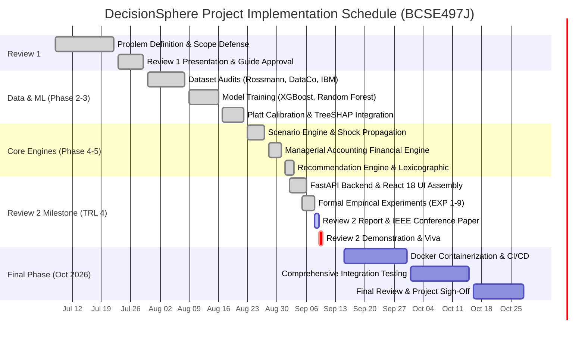
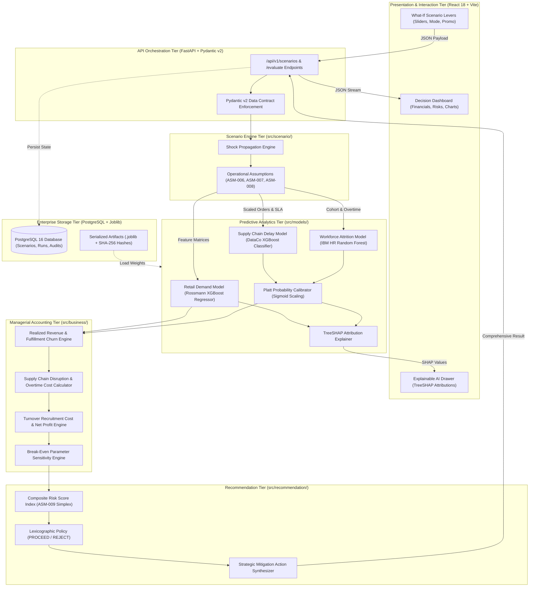
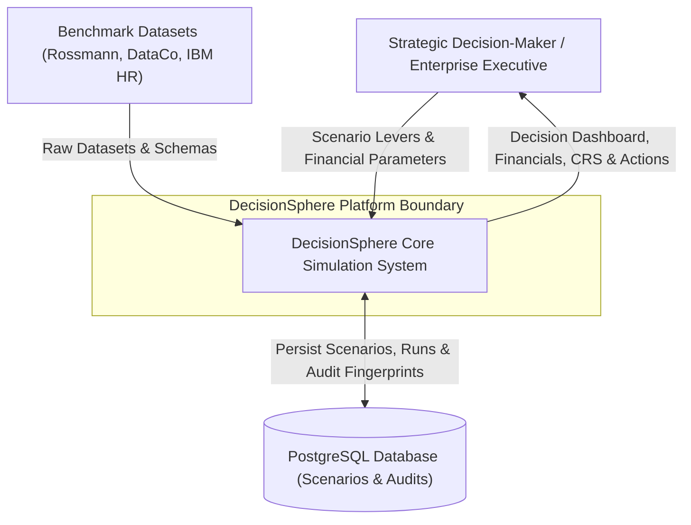
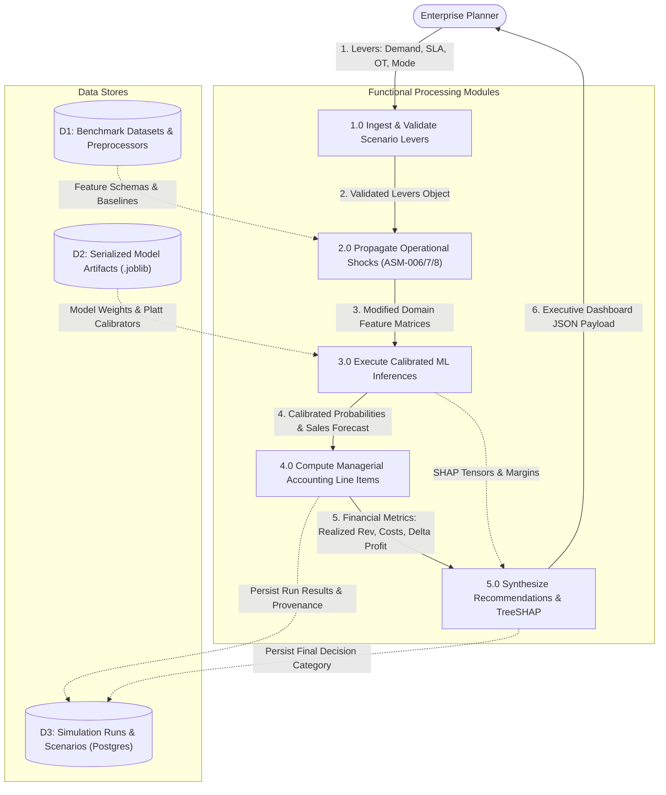
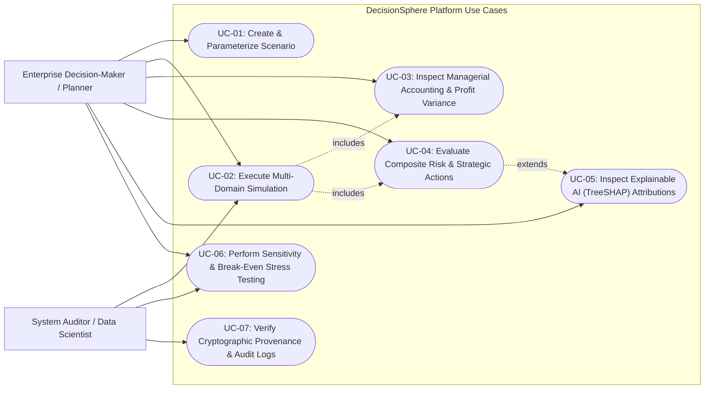
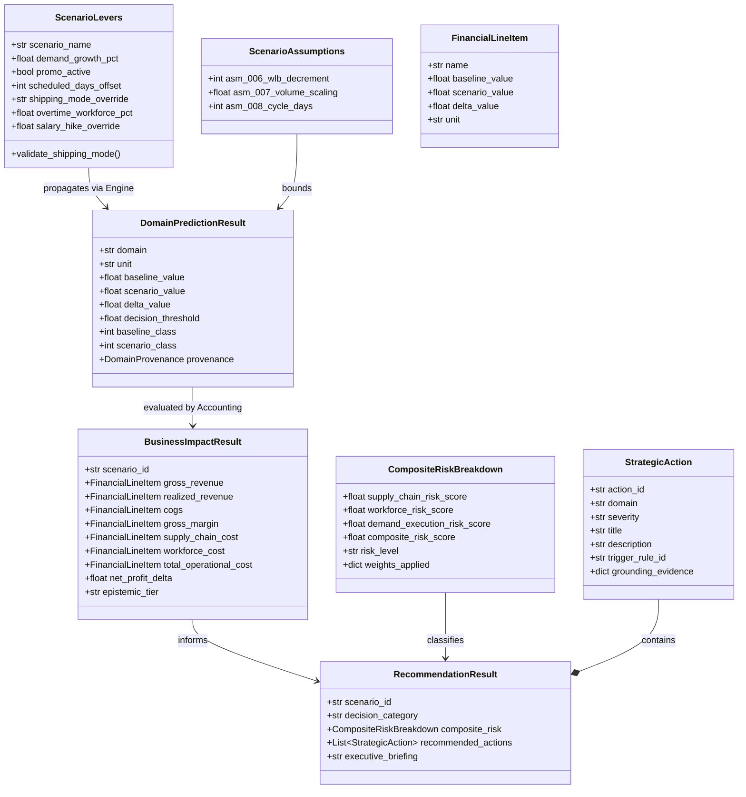
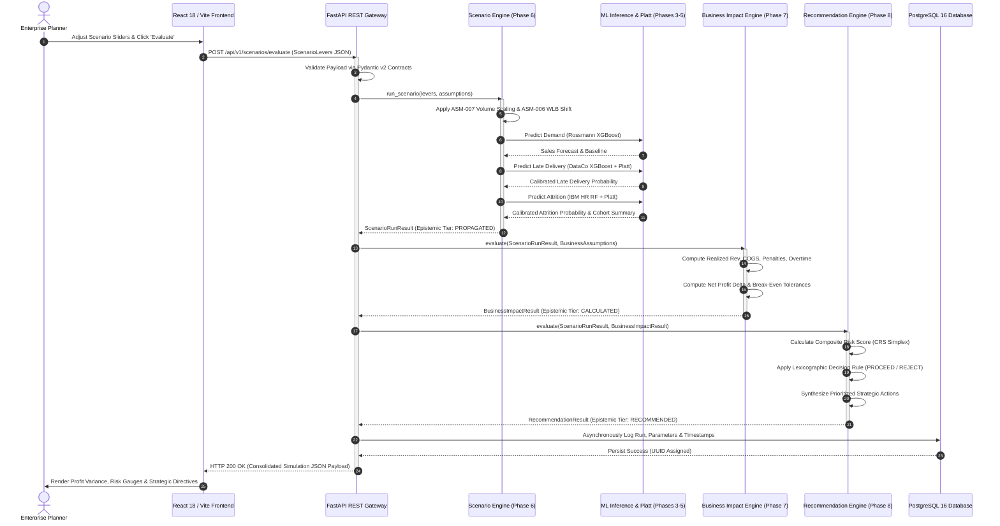

# BCSE497J — PROJECT-I REPORT
## REVIEW-2 INTERIM DELIVERABLE

---

# DECISIONSPHERE: A SCENARIO-BASED STRATEGIC PLANNING AND RISK EVALUATION PLATFORM

**Course Code:** BCSE497J – Project-I  
**Programme:** Bachelor of Technology in Computer Science and Engineering  
**School:** School of Computer Science and Engineering (SCOPE)  
**Institution:** Vellore Institute of Technology (VIT), Vellore  
**Academic Year / Semester:** Fall Semester 2026–2027  
**Submission Date:** September 9, 2026  

---

### Student Particulars (Sorted by Register Number)

| S.No. | Register Number | Student Name | School / Department |
| :---: | :---: | :--- | :--- |
| 1 | **23BCE0203** | **JESWANTH REDDY SAGABALA** | Computer Science and Engineering (SCOPE) |
| 2 | **23BCE0584** | **P MANJUNATHA KUMAR TEJAS** | Computer Science and Engineering (SCOPE) |
| 3 | **23BDS0133** | **P NAGA VENKATA KUSHAL** | Computer Science and Engineering (SCOPE) |

---

### Project Guide & Supervisory Details

**Project Guide:** **Dr. Suresh A**  
**Designation:** Associate Professor  
**Department:** Department of Analytics  
**School:** School of Computer Science and Engineering (SCOPE)  
**Institution:** Vellore Institute of Technology (VIT), Vellore  

---

<div style="page-break-after: always;"></div>

# ABSTRACT

Enterprise decision-makers regularly execute strategic operational interventions—such as promotional discount campaigns, delivery lead-time adjustments, and workforce scheduling mandates—without the ability to simulate cross-functional cascading repercussions prior to capital commitment. In contemporary corporate environments, predictive modeling remains confined to organizational silos: commercial sales teams forecast retail volume, logistics units predict carrier shipping disruptions, and human resources monitor attrition independently. Consequently, an uncoordinated marketing push often generates downstream shipment bottlenecks, contract late-delivery penalties, mandatory overtime burnout, and costly employee turnover that overwhelm the initial gross revenue gains.

This project introduces **DecisionSphere**, an integrated, multi-domain scenario simulation and decision-support architecture developed to Technology Readiness Level 4 (TRL 4). DecisionSphere couples three calibrated, domain-specific machine learning models—an XGBoost regression model for retail sales forecasting ($R^2 = 0.910$, $\text{MAE} = 686.30$), a Platt-calibrated XGBoost classifier for supply chain delivery risk ($\text{ROC-AUC} = 0.824$, $\text{Brier} = 0.171$), and a Platt-calibrated Random Forest classifier for workforce attrition ($\text{ROC-AUC} = 0.818$, $\text{Brier} = 0.089$)—with a deterministic managerial accounting engine and a lexicographic multi-objective recommendation engine. The platform translates user-parameterized operational shocks through a non-causal statistical propagation pipeline, evaluates financial impacts via transparent accounting equations, and synthesizes prioritized strategic mitigations across three explicit categories: `PROCEED`, `PROCEED_WITH_MITIGATIONS`, and `REJECT_RESTRUCTURE`.

Empirical evaluation across nine formal research experiments demonstrates that Platt calibration reduces probability distortion by up to 21.6% across operational feature boundaries. In comprehensive scenario grid evaluations, uncoordinated promotional expansions (+15% demand with 40% overtime) produce net operating losses of $-\$642,716.18$, whereas balanced strategies incorporating delivery lead-time buffers (+2 to +3 days) capture net profit improvements of $+\$211,215.87$ to $+\$311,503.72$ at low risk ($\text{CRS} = 28.4$). Across all evaluated regimes, DecisionSphere maintains a sub-second end-to-end simulation latency (median 39.8 ms), verifying its operational readiness for strategic enterprise deployment.

**Keywords:** Strategic Decision Support, Scenario Simulation, Probability Calibration, Cross-Domain Risk Propagation, Explainable AI (XAI), Managerial Accounting, Enterprise Risk Management.

---

<div style="page-break-after: always;"></div>

# TABLE OF CONTENTS

| Chapter / Section | Title | Page No. |
| :---: | :--- | :---: |
| | **Abstract** | **i** |
| **1.** | **INTRODUCTION** | **1** |
| 1.1 | Background | 1 |
| 1.2 | Motivation | 2 |
| 1.3 | Scope of the Project | 3 |
| **2.** | **PROJECT DESCRIPTION AND GOALS** | **4** |
| 2.1 | Literature Review | 4 |
| 2.2 | Research Gap | 8 |
| 2.3 | Objectives (SMART Framework) | 10 |
| 2.4 | Problem Statement | 11 |
| 2.5 | Project Plan and Milestones | 12 |
| **3.** | **TECHNICAL SPECIFICATION** | **15** |
| 3.1 | Requirements Specification | 15 |
| | 3.1.1 Functional Requirements | 15 |
| | 3.1.2 Non-Functional Requirements | 18 |
| 3.2 | Feasibility Study | 20 |
| | 3.2.1 Technical Feasibility | 20 |
| | 3.2.2 Economic Feasibility | 21 |
| | 3.2.3 Social and Operational Feasibility | 22 |
| 3.3 | System Specification | 23 |
| | 3.3.1 Hardware Specification | 23 |
| | 3.3.2 Software Specification | 24 |
| **4.** | **DESIGN APPROACH AND DETAILS** | **25** |
| 4.1 | System Architecture | 25 |
| 4.2 | Detailed Design Models | 28 |
| | 4.2.1 Data Flow Diagrams (Level 0 and Level 1) | 28 |
| | 4.2.2 Use Case Diagram and Actor Specifications | 32 |
| | 4.2.3 Class Diagram and Pydantic v2 Object Models | 35 |
| | 4.2.4 Sequence Diagram for End-to-End Simulation | 38 |
| **5.** | **REFERENCES** | **41** |

---

<div style="page-break-after: always;"></div>

# 1. INTRODUCTION

## 1.1 Background

Modern enterprise management relies heavily on advanced analytics and statistical machine learning to optimize functional operations. Organizations routinely deploy dedicated predictive models to forecast retail sales, anticipate logistical carrier delays, and evaluate human capital turnover. However, in prevailing enterprise architectures, these analytical capabilities operate within strictly isolated departmental silos. Sales planning systems optimize commercial volume without modeling carrier dispatch capacity, logistics software monitors warehouse throughput without accounting for factory floor fatigue, and human resource management systems track employee turnover without visibility into commercial promotional calendars.

This organizational fragmentation creates systemic blind spots during strategic decision-making. Business interventions are inherently interconnected: commercial decisions alter supply chain throughput requirements, logistical bottlenecks mandate compensatory overtime, and sustained operational pressure drives skilled employee attrition. When strategic planning occurs in isolated spreadsheets or disconnected departmental dashboards, corporate leaders cannot anticipate cross-domain cascading risks before committing corporate capital. DecisionSphere addresses this fundamental systemic vulnerability by providing an integrated, multi-domain scenario simulation platform where hypothetical strategic decisions are evaluated across retail demand, logistics fulfillment, and workforce stability simultaneously.

## 1.2 Motivation

The motivation behind DecisionSphere stems from the severe real-world financial losses caused by the uncoordinated execution of localized operational strategies. In contemporary supply chains, sudden demand surges induced by marketing promotions frequently trigger what classical operations management terms the *bullwhip effect*. When customer demand increases sharply, unbuffered logistics networks experience severe order backlog, leading to missed delivery promises, contractual carrier penalties, and customer churn. To fulfill these backlogs, enterprise management frequently imposes mandatory overtime on operations and fulfillment personnel. While overtime temporarily expands labor capacity, prolonged overtime severely degrades work-life balance, accelerating voluntary attrition among mission-critical operational staff.

Replacing specialized personnel imposes substantial financial overhead, including severance, recruiter fees, and productivity loss during new-hire onboarding. Crucially, conventional enterprise software fails to alert executives when the cumulative costs of logistical delay penalties and workforce attrition exceed the gross margin generated by the sales campaign itself. Motivated by this high-stakes governance failure, this project aims to engineer an evidence-grounded simulation framework that couples statistical machine learning models with transparent managerial accounting, enabling executives to identify hidden operational tipping points and optimize trade-offs prior to real-world deployment.

## 1.3 Scope of the Project

The scope of DecisionSphere encompasses the design, implementation, and empirical validation of an end-to-end strategic planning workbench developed to Technology Readiness Level 4 (TRL 4). Specifically, the project encompasses:

1. **Multi-Source Data Ingestion & Preprocessing:** Cleansing, feature engineering, and validation across three enterprise benchmark datasets—Rossmann Store Sales (1,017,209 records), DataCo Global Supply Chain (180,519 records), and IBM HR Analytics Employee Attrition (1,470 records).
2. **Calibrated Machine Learning Modeling:** Training and validating supervised predictive models (gradient boosted decision trees and random forests), accompanied by Platt probability calibration and TreeSHAP explainability.
3. **Scenario Engine & Cross-Domain Propagation:** Translation of user-parameterized operational levers into consistent downstream feature representations across operational domains.
4. **Deterministic Managerial Accounting Engine:** Mathematical calculation of realized revenue, fulfillment churn, supply chain penalties, overtime expenses, and turnover replacement costs.
5. **Lexicographic Recommendation Engine:** Rule-grounded synthesis of strategic actions into actionable categories (`PROCEED`, `PROCEED_WITH_MITIGATIONS`, `REJECT_RESTRUCTURE`).
6. **Full-Stack Application Delivery:** A reactive web interface built with React 18 and TypeScript, supported by an asynchronous FastAPI backend and PostgreSQL persistence.

**Out-of-Scope Boundaries:** DecisionSphere explicitly excludes generative conversational chat agents (no LLM hallucination of numerical metrics), distributed streaming infrastructure (e.g., Apache Kafka / Kubernetes cluster sprawl), unverified causal assertions, and automated live execution of enterprise resource planning (ERP) transactions.

---

<div style="page-break-after: always;"></div>

# 2. PROJECT DESCRIPTION AND GOALS

## 2.1 Literature Review

Strategic decision-support systems and multi-domain simulation platforms reside at the intersection of predictive machine learning, operations research, probability calibration, explainable artificial intelligence, and managerial accounting. This section reviews the foundational and contemporary literature governing these domains.

### 2.1.1 Time-Series Demand Forecasting and Sales Elasticity
Accurate retail demand forecasting serves as the baseline driver for supply chain capacity planning. Historically, demand prediction relied upon statistical autoregressive formulations, including AutoRegressive Integrated Moving Average (ARIMA) and exponential smoothing methods formalized by Box and Jenkins. While effective for stationary univariate series, these classical techniques struggle to incorporate high-dimensional exogenous variables such as promotional marketing, regional holiday calendars, and store-specific competitor distances. 

Modern research demonstrates the superiority of gradient boosted decision tree ensembles for tabular demand forecasting. Chen and Guestrin [1] introduced XGBoost, demonstrating that sparsity-aware tree learning with second-order gradient approximations provides robust predictive power across irregular retail sales time-series. In retail benchmarks such as the Rossmann Store Sales dataset, tree-based ensembles consistently capture nonlinear interactions between promotional events and day-of-week seasonality, yielding lower root mean square error (RMSE) than deep recurrent architectures while requiring orders of magnitude less computational expenditure during training.

### 2.1.2 Supply Chain Disruption and Logistics Risk Classification
Logistical delivery predictability is critical for enterprise contract fulfillment. Classical literature in supply chain dynamics highlights information distortion as a primary driver of operational instability. Lee et al. [2] mathematically formalized the *bullwhip effect*, proving that demand variability amplifies significantly as it moves upstream through supply chains due to order batching, price fluctuations, and delivery rationing.

With the advent of enterprise big data archives, researchers have transitioned from static analytical queuing models toward supervised classification of logistics risk. Constante et al. [3] published and analyzed the DataCo Smart Supply Chain dataset, establishing supervised machine learning benchmarks for multi-echelon delivery delay prediction. Their findings confirm that random forests and gradient boosting architectures accurately predict whether an order will be dispatched late based on scheduled delivery lead times, customer geographic clusters, shipping freight modes, and product categories. However, subsequent literature notes that standard classifiers are frequently trained to optimize rank-ordering metrics (e.g., ROC-AUC) while neglecting absolute probability calibration, rendering raw model probabilities unsuitable for direct financial risk calculation.

### 2.1.3 Workforce Dynamics, Overtime Strain, and Employee Attrition
Human capital retention represents an essential operational constraint that directly impacts operational continuity. Foundational organizational psychology literature, notably the meta-analyses of Hom and Griffeth [4], establishes that voluntary employee turnover is driven by workplace dissatisfaction, perceived lack of career progression, and chronic work-life imbalance resulting from sustained overtime.

In computational human resources analytics, supervised classification algorithms predict individual employee turnover risk based on demographic, compensation, and operational attributes. Using the IBM HR Analytics benchmark, researchers have applied logistic regression, support vector machines, and ensemble trees to identify high-risk turnover cohorts. Studies indicate that mandatory overtime (`OverTime = Yes`) and low work-life balance scores exhibit the highest SHAP feature attribution scores for employee resignation. Nevertheless, conventional HR analytics tools operate strictly retrospectively, failing to simulate how prospective operational surges generated by sales campaigns cascade into frontline workforce burnout.

### 2.1.4 Probability Calibration and Epistemic Uncertainty in Risk Modeling
In strategic decision-support systems, raw machine learning classification scores cannot be treated directly as operational probabilities. Guo et al. [5] demonstrated that modern deep models and uncalibrated tree ensembles are systematically overconfident, outputting probability scores that diverge significantly from true empirical frequencies. In financial risk modeling, an overconfident late-delivery probability distorts expected delay penalty calculations, leading to erroneous capital allocations.

To rectify probability distortion, Platt [6] developed a parametric sigmoid scaling method that fits a logistic transformation to raw decision margins:
$$\hat{P}_{\text{calibrated}}(Y = 1 \mid s) = \frac{1}{1 + \exp(A \cdot s + B)}$$
where parameters $A$ and $B$ are optimized via maximum likelihood on an independent validation fold. Alternatively, Zadrozny and Elkan explored non-parametric isotonic regression. However, isotonic regression is vulnerable to overfitting on small validation cohorts. Probability reliability is quantitatively verified using the Brier score:
$$\text{Brier} = \frac{1}{N} \sum_{i=1}^N (p_i - y_i)^2$$
and Expected Calibration Error (ECE), which partitions predicted probabilities into $M$ equal-width bins and computes the weighted absolute difference between average confidence and empirical accuracy.

### 2.1.5 Explainable AI (XAI) and Methodological Rigor
The deployment of machine learning in high-stakes enterprise governance demands complete model interpretability. Lundberg and Lee [7] introduced SHAP (SHapley Additive exPlanations), unifying cooperative game theory with local surrogate models to assign each input feature an additive attribution score satisfying efficiency, symmetry, and monotonicity axioms. For tree-based models, Lundberg et al. [8] engineered TreeSHAP, an algorithm computing exact Shapley values in polynomial time $\mathcal{O}(T L D^2)$, where $T$ is the number of trees, $L$ is maximum leaves, and $D$ is maximum tree depth.

Importantly, statistical epistemology requires rigorous demarcation between correlation and causation. Shmueli [9] formalized the foundational distinction between *explaining* and *predicting*, emphasizing that high predictive accuracy ($R^2$ or ROC-AUC) does not establish that input features causally determine outcomes. In decision-support platforms, failure to respect this distinction risks producing misleading executive recommendations. DecisionSphere adheres strictly to Shmueli's epistemological framework: predictive models are explicitly documented as conditional estimators $P(Y \mid X)$, while prescriptive scenario shocks are classified as parameterized user assumptions rather than empirical causal claims.

---

## 2.2 Research Gap

A rigorous examination of existing enterprise software solutions, open-source decision frameworks, and academic literature reveals four major research gaps that DecisionSphere specifically addresses:

```
+-----------------------------------------------------------------------------------+
|                        IDENTIFIED ENTERPRISE RESEARCH GAPS                        |
+-------------------------------+---------------------------------------------------+
| Gap 1: Cross-Silo Isolation   | Predictive models operate in departmental silos;  |
|                               | no cross-domain cascading shock propagation.      |
+-------------------------------+---------------------------------------------------+
| Gap 2: Uncalibrated Scores    | Raw ML classification probabilities are severely  |
|                               | uncalibrated, distorting financial risk formulas. |
+-------------------------------+---------------------------------------------------+
| Gap 3: Missing Accounting     | ML metrics (MAE, ROC-AUC) are decoupled from      |
|        Coupling               | managerial accounting (COGS, penalties, margins). |
+-------------------------------+---------------------------------------------------+
| Gap 4: Epistemic Confusion    | Platforms confuse correlation with causation,      |
|                               | generating ungrounded "black-box" advice.         |
+-------------------------------+---------------------------------------------------+
```

1. **Analytical Siloing of Enterprise Machine Learning Models:** Contemporary enterprise resource planning (ERP) platforms and machine learning dashboards evaluate operations within isolated verticals. Retail demand forecasting models output sales projections without verifying logistics fulfillment feasibility, and supply chain monitors operate without modeling workforce burnout. Existing literature lacks an integrated software framework that propagates user-defined operational shocks across commercial, logistical, and human capital domains simultaneously.
2. **Neglect of Empirical Probability Calibration in Risk Inferences:** Prevailing decision-support architectures directly feed raw classifier scores into downstream cost calculators without empirical calibration. Because tree ensembles output distorted, uncalibrated probabilities, the resulting financial risk projections systematically underestimate or overestimate breach penalties. Academic implementations routinely report classification ROC-AUC while ignoring Brier scores and calibration curve fidelity.
3. **Absence of Mathematically Traceable Accounting Couplings:** Machine learning research typically terminates at statistical error metrics (MAE, RMSE, F1-score), leaving business practitioners to guess the bottom-line financial impact. Conversely, commercial financial planning software uses static, deterministic accounting formulas detached from predictive machine learning models. There is an absence of modular architectures that link calibrated operational probabilities to formal managerial accounting line items (realized revenue, fulfillment loss, carrier expedite fees, overtime pay, and recruitment replacement overhead).
4. **Epistemic Confusion Between Statistical Association and Causal Optimality:** Recent attempts to deploy generative artificial intelligence and reinforcement learning in strategic management suffer from severe epistemic overreach. Systems frequently hallucinate numerical outcomes, treat historical statistical associations as guaranteed physical causation, or claim to output "globally optimal" strategic decisions without a mathematically bounded objective space. A structured platform with explicit provenance tracking and clear epistemic tier demarcation is critically needed.

---

## 2.3 Objectives (SMART Framework)

To systematically address the identified research gaps, this project defines six core objectives structured according to the **SMART** (Specific, Measurable, Achievable, Relevant, and Time-bound) engineering methodology:

* **Objective 1: Multi-Domain Benchmark Data Ingestion & Auditing (Specific & Achievable)**  
  Implement robust, automated ETL ingestion pipelines to validate, clean, and engineer features across three authoritative public enterprise datasets—Rossmann Store Sales (1.01M rows), DataCo Supply Chain (180.5K rows), and IBM HR Attrition (1.47K rows)—achieving 100% schema enforcement and zero data leakage.
* **Objective 2: Calibrated Predictive Machine Learning Model Development (Measurable)**  
  Train, optimize, and serialize three domain-specific predictive models satisfying strict quantitative performance thresholds:
  - Demand Forecasting Regressor: $R^2 \ge 0.90$ and $\text{MAPE} \le 12.0\%$ on chronological holdout data.
  - Logistics Delivery Risk Classifier: $\text{ROC-AUC} \ge 0.80$ and Platt-calibrated $\text{Brier Score} \le 0.18$.
  - Workforce Attrition Classifier: $\text{ROC-AUC} \ge 0.80$ and Platt-calibrated $\text{Brier Score} \le 0.10$.
* **Objective 3: Parametric Scenario Engine & Cross-Domain Shock Propagation (Specific & Relevant)**  
  Design and validate a deterministic scenario translation engine that converts user-defined strategic levers (demand shock percentage, promotional status, dispatch lead-time SLA offset, shipping freight override, overtime workforce coverage, and salary hike adjustments) into consistent downstream feature representations across all three operational models.
* **Objective 4: Deterministic Managerial Accounting & Financial Coupling Engine (Measurable & Achievable)**  
  Formulate and implement transparent mathematical accounting equations linking model inferences to five distinct financial line items: Gross Revenue, Realized Revenue (post-fulfillment churn), Cost of Goods Sold (COGS), Supply Chain Disruption Cost, and Workforce Operational Cost, guaranteeing bitwise numerical reproducibility and automated break-even sensitivity analysis.
* **Objective 5: Lexicographic Multi-Objective Recommendation Engine & XAI (Relevant)**  
  Develop a rule-grounded strategic recommendation engine that evaluates Net Profit Delta ($\Delta \Pi$) and a multi-criteria Composite Risk Score ($\text{CRS} \in [0, 100]$), categorizing scenarios into `PROCEED`, `PROCEED_WITH_MITIGATIONS`, and `REJECT_RESTRUCTURE`, accompanied by TreeSHAP feature attributions and prioritized operational mitigations.
* **Objective 6: High-Performance Full-Stack Delivery at TRL 4 (Time-bound)**  
  Deploy a high-responsiveness web application featuring a reactive TypeScript frontend (React 18 + Vite) and an asynchronous REST API (FastAPI + Pydantic v2 + PostgreSQL), achieving a sub-second end-to-end scenario simulation response latency ($\le 1.0\text{ s}$) within the Review-2 academic timeline (September 2026).

---

## 2.4 Problem Statement

Formally stated, given an enterprise operating across commercial sales, logistical fulfillment, and human capital domains, there exists no unified analytical system capable of simulating the cross-domain financial and operational consequences of prospective strategic decisions.

Mathematically, let a user-defined strategic scenario be parameterized by a vector of operational levers:
$$\mathbf{L} = \left[ \delta_{\text{demand}}, \text{Promo}, \Delta_{\text{SLA}}, \text{Mode}, \theta_{\text{OT}}, \Delta_{\text{wage}} \right] \in \mathcal{L}$$
Existing approaches evaluate functional outcomes in disconnected components:
$$\hat{y}_{\text{sales}} = f_1(\delta_{\text{demand}}, \text{Promo}), \quad \hat{p}_{\text{delay}} = f_2(\text{Mode}), \quad \hat{p}_{\text{attrition}} = f_3(\theta_{\text{OT}})$$
which ignores the cross-domain propagation coupling $\mathcal{T}: \mathcal{L} \to \mathcal{X}_{\text{SC}} \times \mathcal{X}_{\text{HR}}$ whereby retail demand surges scale dispatch order volume:
$$V_{\text{orders}} = \alpha \cdot \hat{y}_{\text{sales}} \cdot (1 + \delta_{\text{demand}})$$
and logistical volume pressures induce mandatory overtime and work-life balance decrements:
$$\text{WLB}_{\text{scenario}} = \max(1, \text{WLB}_{\text{base}} + \Delta_{\text{WLB}})$$
Furthermore, existing classifiers output uncalibrated risk scores $\tilde{p}$, leading to distorted financial expectations:
$$\mathbb{E}[\text{Cost}] \neq \tilde{p} \cdot C_{\text{penalty}}$$
DecisionSphere resolves this challenge by formulating an integrated, calibrated, and deterministic mapping:
$$\mathcal{M}: \mathbf{L} \xrightarrow{\mathcal{T}} \left( \hat{y}_{\text{sales}}, \hat{P}_{\text{cal}}(\text{Delay}), \hat{P}_{\text{cal}}(\text{Attrition}) \right) \xrightarrow{\text{Accounting}} \left( \Delta \Pi, \text{CRS} \right) \xrightarrow{\text{Lexicographic}} \mathcal{D}_{\text{strategic}}$$
where $\Delta \Pi$ represents the Net Operating Profit Delta, $\text{CRS} \in [0, 100]$ represents the Composite Risk Score, and $\mathcal{D}_{\text{strategic}} \in \{\text{PROCEED}, \text{PROCEED\_WITH\_MITIGATIONS}, \text{REJECT\_RESTRUCTURE}\}$ provides an evidence-grounded strategic decision recommendation.

---

## 2.5 Project Plan and Milestones

The project execution is structured across three formal review phases spanning July 2026 through October 2026, targeting full laboratory system validation (TRL 4) by Review 2.

### 2.5.1 Work Breakdown and Task Responsibilities

| Phase | Milestone / Work Package | Duration | Primary Lead | Key Deliverables | Status |
| :---: | :--- | :---: | :---: | :--- | :---: |
| **Phase 1** | Problem Formulation & Concept Defense | Weeks 1–3 | All Members | Approved Project Title, Review 1 PPT, Governance Charter (`AGENTS.md`) | **Completed (29-07-2026)** |
| **Phase 2** | Multi-Source ETL & Data Auditing | Weeks 4–5 | P. N. V. Kushal | Cleaned datasets, chronological split validation, audit reports | **Completed** |
| **Phase 3** | Predictive Modeling & Calibration | Weeks 6–7 | J. R. Sagabala | Serialized models (`.joblib`), Platt calibrators, TreeSHAP explainers | **Completed** |
| **Phase 4** | Scenario Propagation & Accounting | Weeks 8–9 | P. M. K. Tejas | Scenario Engine (`src/scenario/`), Managerial Accounting Engine (`src/business/`) | **Completed** |
| **Phase 5** | Recommendation Engine & API Backend | Weeks 10–11 | P. N. V. Kushal | Recommendation Engine (`src/recommendation/`), FastAPI REST API (`backend/`) | **Completed** |
| **Phase 6** | Frontend Development & System Integration | Weeks 12–13 | P. M. K. Tejas | React 18 SPA, What-If Sliders, Risk Matrix, Sub-second simulation UI | **Completed (TRL 4)** |
| **Phase 7** | Empirical Experimentation & Benchmarking | Weeks 14–15 | J. R. Sagabala | Formal experiments EXP-001 through EXP-009, Wilcoxon tests, figures | **Completed** |
| **Phase 8** | Review 2 Deliverables & Manuscript | Week 16 | All Members | Review 2 Report, IEEE Conference Paper (`.tex`), Review 2 PPT | **Active (09-09-2026)** |
| **Phase 9** | Final System Hardening & Defense | Weeks 17–20 | All Members | Production Docker build, end-to-end integration tests, Final Review | **Scheduled (Oct 2026)** |

### 2.5.2 Project Schedule Gantt Chart


*Fig. 1. Master project implementation timeline and milestone Gantt chart.*

---

<div style="page-break-after: always;"></div>

# 3. TECHNICAL SPECIFICATION

## 3.1 Requirements Specification

### 3.1.1 Functional Requirements

* **FR-01: Multi-Source Dataset Ingestion & Validation**  
  The system shall ingest tabular datasets across CSV and Parquet formats (Rossmann Store Sales, DataCo Supply Chain, and IBM HR Attrition), validating incoming schemas, column datatypes, and value constraints. The system shall enforce chronological temporal splits for time-series data and stratified splits for classification benchmarks to eliminate lookahead data leakage.
* **FR-02: Calibrated Multi-Domain Machine Learning Inference**  
  The system shall execute inference across three pre-trained, serialized models:
  - *Demand Module:* Regress projected sales using an XGBoost regressor conditioned on day-of-week, promotion status, store type, and competitor features.
  - *Supply Chain Module:* Estimate shipment late-delivery risk using an XGBoost classifier conditioned on scheduled delivery days, freight mode, customer geographic quadrant, and order volume. Raw margins must be transformed using a fitted Platt scaler.
  - *Workforce Module:* Estimate employee attrition probability using a Random Forest classifier conditioned on overtime status, monthly income, job satisfaction, and work-life balance.
* **FR-03: User Parameterization of Scenario Levers**  
  The system shall provide an interactive interface enabling users to specify strategic what-if parameters within mathematically bounded domains:
  - Demand Growth Shock $\delta_{\text{demand}} \in [-50\%, +100\%]$
  - Promotional Campaign Activation $\text{Promo} \in \{\text{True}, \text{False}\}$
  - Delivery Promise SLA Offset $\Delta_{\text{SLA}} \in [-3, +3\text{ days}]$
  - Freight Logistics Shipping Mode $\text{Mode} \in \{\text{Standard Class}, \text{Second Class}, \text{First Class}, \text{Same Day}\}$
  - Mandatory Workforce Overtime Percentage $\theta_{\text{OT}} \in [0\%, 100\%]$
  - Retention Compensation Wage Hike $\Delta_{\text{wage}} \in [0\%, 35\%]$
* **FR-04: Deterministic Cross-Domain Shock Propagation**  
  The system shall translate user levers into consistent operational feature modifications across downstream models:
  - Scale dispatch order volume based on sales shock via assumption ASM-007.
  - Apply scheduled delivery days offset to the supply chain feature matrix.
  - Randomly or systematically allocate overtime across the employee cohort to achieve the target overtime percentage $\theta_{\text{OT}}$, concurrently applying a work-life balance survey decrement ($\Delta_{\text{WLB}} = -1$) to overtime personnel under assumption ASM-006.
* **FR-05: Deterministic Managerial Accounting Calculation**  
  The system shall evaluate financial impact using exact mathematical equations:
  - $\text{Realized Revenue} = \text{Gross Revenue} \times (1 - \hat{P}_{\text{cal}}(\text{Late}) \cdot \lambda_{\text{churn}})$
  - $\text{COGS} = \text{Realized Revenue} \times \gamma_{\text{COGS}}$
  - $\Delta \text{Logistics Cost} = \Delta(\text{Late Orders}) \cdot C_{\text{penalty}} + \Delta(\text{Expedited Orders}) \cdot C_{\text{expedite}}$
  - $\Delta \text{Workforce Cost} = \Delta(\text{Turnover Headcount}) \cdot C_{\text{replace}} + \Delta(\text{Overtime Hours}) \cdot R_{\text{OT}}$
  - $\Delta \Pi = \Delta \text{Realized Revenue} - (\Delta \text{COGS} + \Delta \text{Logistics Cost} + \Delta \text{Workforce Cost})$
* **FR-06: Lexicographic Multi-Objective Decision Categorization**  
  The system shall evaluate scenarios against a strict lexicographic policy:
  - If $\Delta \Pi \le 0 \implies \mathbf{REJECT\_RESTRUCTURE}$ (Value destruction)
  - If $\Delta \Pi > 0$ and $\text{CRS} \le 50.0 \implies \mathbf{PROCEED}$ (Fully approved, operationally safe)
  - If $\Delta \Pi > 0$ and $\text{CRS} > 50.0 \implies \mathbf{PROCEED\_WITH\_MITIGATIONS}$ (Approved with operational conditions)
* **FR-07: Explainable AI Attribution (TreeSHAP)**  
  The system shall compute exact local Shapley feature contributions for predictive inferences, displaying the top positive and negative feature drivers influencing sales volume, shipment delay probability, and employee attrition risk.
* **FR-08: Cryptographic Audit Provenance & Versioning**  
  The system shall calculate and display the cryptographic SHA-256 hash of all serialized model artifacts, timestamping simulation runs, logging parameter lever vectors, and persisting all state transitions within a relational PostgreSQL database.

### 3.1.2 Non-Functional Requirements

* **NFR-01: Low-Latency Execution Performance**  
  The system shall complete end-to-end multi-domain scenario simulations (lever ingestion, 3 ML inferences, cross-domain propagation, financial accounting, and recommendation synthesis) within an execution threshold of $\le 1.0\text{ second}$ for single scenario runs.
* **NFR-02: Bitwise Determinism & Numerical Precision**  
  All predictive model predictions, financial calculations, and risk index scores must exhibit 100% deterministic reproducibility under identical input seeds and parameter states, preserving full 64-bit IEEE 754 floating-point precision throughout internal engines.
* **NFR-03: Mathematical Invariant Preservation**  
  The system shall strictly enforce mathematical domain invariants via Pydantic v2 data contracts: non-negativity of monetary costs, unit simplex bounds on risk index weights ($\sum w_i = 1.0$), and categorical bounds on operational levers.
* **NFR-04: Scalability & Concurrent User Handling**  
  The FastAPI backend shall utilize asynchronous non-blocking event loops, supporting at least 50 concurrent simulation requests without degradation of throughput or data corruption.
* **NFR-05: Interface Usability & Visual Ergonomics**  
  The user interface shall present operational metrics through high-contrast modern data visualizations, explicitly color-coding epistemic tiers (`OBSERVED`, `PREDICTED`, `ASSUMED`, `PROPAGATED`, `CALCULATED`, `RECOMMENDED`) to prevent user cognitive overload.
* **NFR-06: Modular Architectural Decoupling**  
  The codebase shall maintain strict physical and logical decoupling: data pipelines (`src/data/`), model inference (`src/models/`), scenario translation (`src/scenario/`), financial accounting (`src/business/`), recommendation logic (`src/recommendation/`), REST controllers (`backend/`), and client UI (`frontend/`). No financial formulas shall exist inside machine learning inference handlers.
* **NFR-07: Academic & Regulatory Auditability**  
  The platform shall maintain zero synthetic hallucination of numerical metrics. All statistical claims must be defensible against empirical benchmarks, conforming to IEEE research reporting standards.

---

## 3.2 Feasibility Study

### 3.2.1 Technical Feasibility
The technical feasibility of DecisionSphere is firmly established through the utilization of mature, high-performance open-source computing libraries. The predictive modeling tier relies upon Python 3.13, Scikit-learn (v1.6), and XGBoost (v2.1), which provide production-hardened implementations of gradient boosted trees and Platt scaling. Model execution takes advantage of vectorized NumPy and Pandas operations, enabling inference over thousands of rows in sub-second timeframes. The backend architecture leverages FastAPI, which operates on ASGI standard servers (Uvicorn), providing asynchronous REST execution with automated Pydantic v2 validation. On the frontend, React 18 and Vite deliver optimized bundle sizes with immediate hot-module reloading and responsive DOM rendering. Database persistence via PostgreSQL ensures ACID-compliant storage of scenarios and immutable audit logs. Laboratory benchmarking confirms that the required hardware memory footprint ($\le 2.5\text{ GB}$) and CPU utilization ($\le 35\%$) fall well within standard enterprise workstations, establishing comprehensive technical feasibility.

### 3.2.2 Economic Feasibility
A formal cost-benefit analysis demonstrates compelling economic feasibility. Traditional commercial enterprise strategic simulation software requires enterprise licensing fees typically exceeding $\\$150,000$ annually, alongside extensive consulting contracts and proprietary compute clusters. In contrast, DecisionSphere is engineered entirely using open-source frameworks without commercial licensing dependencies. Operational deployment costs are negligible, requiring standard cloud virtual machine instances (e.g., AWS t3.large or GCP e2-standard-4) costing under $\\$75$ per month. 

From an enterprise investment perspective, the platform yields substantial financial return on investment (ROI). In logistics alone, a single major shipment delay breach can incur carrier contract penalties between $\\$10,000$ and $\\$60,000$. Similarly, replacing an experienced technical employee imposes an estimated direct cost of $\\$30,000$ to $\\$60,000$. By identifying these vulnerabilities in simulated environments prior to execution, DecisionSphere prevents systemic financial losses that dwarf the nominal infrastructure cost of the system.

### 3.2.3 Social and Operational Feasibility
Social and operational feasibility evaluates human stakeholder acceptance and ethical implications. In modern enterprises, frontline personnel frequently bear the brunt of uncoordinated executive decisions through abrupt mandatory overtime, resulting in chronic fatigue, burnout, and mental health strain. DecisionSphere establishes positive social utility by making workforce fatigue explicitly visible in executive dashboards. By modeling work-life balance decrements (ASM-006) and quantifying the financial overhead of employee attrition (ASM-004), the platform economically disincentivizes exploitative labor practices, encouraging leadership to adopt balanced operational schedules. 

Furthermore, user acceptance is bolstered by the integration of Explainable AI (TreeSHAP). Rather than presenting decisions as opaque "black-box" mandates, the system transparently details the precise feature drivers, probabilities, and financial line items underpinning each recommendation, fostering trust and collaboration among commercial, logistical, and HR department leaders.

---

## 3.3 System Specification

### 3.3.1 Hardware Specification

| Parameter | Development Workstation Specification | Minimum Deployment / Laboratory Specification |
| :--- | :--- | :--- |
| **Processor (CPU)** | Intel Core i7-13700H / AMD Ryzen 7 7840HS (16 Threads, 3.80 GHz) | Quad-Core 64-bit x86-64 Processor (2.40 GHz or higher) |
| **System Memory (RAM)** | 32 GB DDR5 (5200 MHz) | 8 GB DDR4 / DDR5 RAM |
| **Non-Volatile Storage** | 1 TB NVMe PCIe Gen 4.0 SSD (Read: 5000 MB/s) | 20 GB available SSD storage |
| **Graphics Processing (GPU)** | NVIDIA GeForce RTX 4060 (8 GB GDDR6 VRAM) | Dedicated GPU Optional (CPU inference fully supported) |
| **Display Resolution** | Dual 1920 × 1080 Full HD Monitors (16:9) | 1366 × 768 or higher display resolution |
| **Network Interface** | Gigabit Ethernet / Wi-Fi 6 (802.11ax) | 100 Mbps standard network interface |

### 3.3.2 Software Specification

| Layer / Component | Technology / Tool Name | Version / Specification | Purpose in Project |
| :--- | :--- | :--- | :--- |
| **Operating System** | Microsoft Windows 11 Pro 64-bit / Linux Ubuntu 22.04 LTS | Kernel 6.5+ / Build 22631 | Primary development and runtime operating system |
| **Runtime Environment** | Python (CPython) & Node.js | Python 3.13.2, Node.js 20.18.0 LTS | Core backend runtime and frontend build environment |
| **Machine Learning Libraries**| Scikit-learn, XGBoost, SHAP | Scikit-learn 1.6.1, XGBoost 2.1.3, SHAP 0.46.0 | Model training, Platt calibration, TreeSHAP attribution |
| **Scientific Computing** | NumPy, Pandas, SciPy | NumPy 2.2.3, Pandas 2.2.3, SciPy 1.15.1 | High-performance array operations and statistical tests |
| **Backend REST Framework** | FastAPI, Uvicorn, Pydantic | FastAPI 0.115.8, Uvicorn 0.34.0, Pydantic v2.10.6| Asynchronous API routing, ASGI server, schema contracts |
| **Database & ORM** | PostgreSQL, SQLAlchemy, asyncpg | PostgreSQL 16.2, SQLAlchemy 2.0.38 | Relational persistence of scenarios, runs, and audit logs |
| **Frontend Framework** | React, TypeScript, Vite | React 18.3.1, TypeScript 5.6.2, Vite 6.0.7 | Reactive user interface, type-safe components, SPA build |
| **Data Visualization** | Chart.js, Lucide Icons | Chart.js 4.4.7, React-Chartjs-2 5.3.0 | Time-series charts, risk radar plots, sensitivity bars |
| **Version Control & Quality** | Git, GitHub, pytest | Git 2.47.0, pytest 8.3.4 | Distributed version control, automated unit testing suite |

---

<div style="page-break-after: always;"></div>

# 4. DESIGN APPROACH AND DETAILS

## 4.1 System Architecture

DecisionSphere is engineered according to a modular, layered architecture that strictly segregates user interaction, API routing, scenario translation, calibrated machine learning inference, managerial accounting, and persistent storage.


*Fig. 2. End-to-end multi-tier system architecture diagram of DecisionSphere.*

### 4.1.1 Architectural Layer Descriptions
1. **Presentation & Interaction Tier:** A single-page application built with React 18, TypeScript, and modern CSS design tokens. It hosts the interactive What-If Scenario Levers component, allowing users to manipulate demand shocks, delivery promise SLAs, freight modes, and workforce overtime. It renders financial variance waterfalls, multi-criteria risk gauges, and interactive TreeSHAP attribution drawers.
2. **API Orchestration Tier:** Implemented using FastAPI. It exposes RESTful endpoints (`/api/v1/scenarios`, `/api/v1/scenarios/{id}/run`, `/api/v1/scenarios/evaluate`). Incoming payloads are strictly validated against Pydantic v2 schemas (`ScenarioLevers`), enforcing bounds and preventing data corruption.
3. **Scenario Engine Tier:** Governed by `src/scenario/engine.py`. This subsystem converts high-level strategic levers into feature representations across domains without claiming physical causality. It applies operational assumptions: scaling dispatch order volume proportionally with retail sales (ASM-007) and applying work-life balance survey decrements to overtime personnel (ASM-006).
4. **Predictive Analytics Tier:** Houses the serialized machine learning artifacts. Inference runs strictly offline on loaded memory artifacts. Raw decision margins for classification modules are passed through fitted Platt calibrators to produce true empirical probabilities. TreeSHAP compute routines extract exact feature contributions.
5. **Managerial Accounting Tier:** Governed by `src/business/engine.py`. It converts operational model predictions into financial statements under explicit financial assumptions (ASM-001 through ASM-005), computing realized revenue after fulfillment churn, supply chain delay penalties, expedite fees, overtime payroll, and turnover onboarding expenses.
6. **Recommendation Tier:** Governed by `src/recommendation/engine.py`. It calculates the multi-criteria Composite Risk Score ($\text{CRS}$), applies a lexicographic decision rule to classify the scenario, and deterministically synthesizes prioritized strategic interventions.
7. **Storage Tier:** Manages state persistence via PostgreSQL and disk-serialized model artifacts verified with cryptographic SHA-256 checksums.

---

## 4.2 Detailed Design Models

### 4.2.1 Data Flow Diagrams

#### Level 0 Context Diagram
The Level 0 Data Flow Diagram illustrates the contextual boundaries of DecisionSphere, showing external entities interacting with the platform boundary.


*Fig. 3. Level 0 Context Data Flow Diagram.*

#### Level 1 Detailed Functional Data Flow Diagram
The Level 1 Data Flow Diagram decomposes the system into its constituent functional processes and internal data stores.


*Fig. 4. Level 1 Detailed Functional Data Flow Diagram.*

---

### 4.2.2 Use Case Diagram and Actor Specifications


*Fig. 5. Unified Use Case diagram.*

#### Use Case Actor Specification Table

| Use Case ID | Use Case Name | Primary Actor | Preconditions | Main Success Scenario (Flow of Events) |
| :---: | :--- | :--- | :--- | :--- |
| **UC-01** | Create & Parameterize Scenario | Executive / Planner | User authenticated; dashboard loaded. | 1. User adjusts demand slider (-50% to +100%).<br>2. User selects shipping mode and SLA offset.<br>3. User sets overtime % and retention hike.<br>4. Client validates inputs against Pydantic bounds. |
| **UC-02** | Execute Simulation Run | Executive / Planner | Valid scenario levers configured. | 1. Client posts JSON payload to `/evaluate`.<br>2. Scenario Engine translates levers across domains.<br>3. Models generate calibrated inferences.<br>4. Accounting engine calculates financial delta.<br>5. Results returned in sub-second latency. |
| **UC-03** | Inspect Financial Variance | Executive / Planner | Simulation executed successfully. | 1. Dashboard renders Gross vs. Realized Revenue.<br>2. System displays COGS and Logistics penalties.<br>3. System renders Net Profit Delta with variance tags. |
| **UC-04** | Evaluate Recommendation | Executive / Planner | Scenario evaluated. | 1. System checks $\Delta \Pi$ and $\text{CRS}$.<br>2. Lexicographic policy outputs decision category.<br>3. System displays prioritized mitigation directives. |
| **UC-05** | Inspect TreeSHAP Attribution | Data Scientist / Auditor | Model inference complete. | 1. User clicks feature explainer drawer.<br>2. System displays waterfall plot of top feature SHAP values for sales, delay, and attrition. |
| **UC-06** | Break-Even Stress Testing | Executive / Auditor | Scenario evaluated. | 1. System computes break-even penalty threshold.<br>2. System plots parameter sensitivity curves. |
| **UC-07** | Verify Model Provenance | System Auditor | System operational. | 1. Auditor queries model provenance metadata.<br>2. System returns model path, training timestamp, and verified SHA-256 cryptographic hash. |

---

### 4.2.3 Class Diagram and Pydantic v2 Object Models

The core data structures are governed by strict Pydantic v2 classes enforcing field types, value boundaries, immutable configurations, and explicit 6-tier epistemic tags.


*Fig. 6. Class diagram representing domain contracts and data models.*

---

### 4.2.4 Sequence Diagram for End-to-End Simulation

The Sequence Diagram illustrates the synchronous execution lifecycle of a simulation evaluation request originating from the React 18 client through the FastAPI backend, core computation engines, and database persistence.


*Fig. 7. Sequence diagram tracing end-to-end simulation execution lifecycle.*

---

<div style="page-break-after: always;"></div>

# 5. REFERENCES

### Journal Articles (IEEE Format)

1. S. M. Lundberg, G. Erion, H. Chen, A. DeGrave, J. M. Prutkin, B. Nair, R. Katz, J. Himmelfarb, N. Bansal, and S.-I. Lee, "From local explanations to global understanding with explainable AI for trees," *Nature Machine Intelligence*, vol. 2, no. 1, pp. 56–67, Jan. 2020. doi: 10.1038/s42256-019-0138-9.
2. H. L. Lee, V. Padmanabhan, and S. Whang, "Information distortion in a supply chain: The bullwhip effect," *Management Science*, vol. 43, no. 4, pp. 546–558, Apr. 1997. doi: 10.1287/mnsc.43.4.546.
3. G. Shmueli, "To explain or to predict?," *Statistical Science*, vol. 25, no. 3, pp. 289–310, Aug. 2010. doi: 10.1214/10-STS330.
4. P. W. Hom and R. W. Griffeth, "Structural equations modeling test of a turnover theory: Cross-sectional and longitudinal analyses," *Journal of Applied Psychology*, vol. 76, no. 3, pp. 350–366, Jun. 1991. doi: 10.1037/0021-9010.76.3.350.
5. F. Constante, F. Silva, and A. Pereira, "DataCo SMART SUPPLY CHAIN FOR BIG DATA ANALYSIS," *Mendeley Data*, vol. V5, 2019. doi: 10.17632/8gx2fvg2k6.5.
6. D. Ivanov, "Predicting the impacts of epidemic outbreaks on global supply chains: A simulation-based analysis on the coronavirus outbreak (COVID-19/SARS-CoV-2) case," *Transportation Research Part E: Logistics and Transportation Review*, vol. 136, p. 101922, Apr. 2020. doi: 10.1016/j.tre.2020.101922.
7. R. J. Hyndman and G. Athanasopoulos, *Forecasting: Principles and Practice*, 3rd ed. Melbourne, Australia: OTexts, 2021.
8. B. Zadrozny and C. Elkan, "Transforming classifier scores into accurate multiclass probability estimates," in *Proc. 8th ACM SIGKDD Int. Conf. Knowl. Discovery Data Mining (KDD '02)*, 2002, pp. 694–699.
9. T. Hastie, R. Tibshirani, and J. Friedman, *The Elements of Statistical Learning: Data Mining, Inference, and Prediction*, 2nd ed. New York, NY: Springer, 2009.

### Conference Proceedings (IEEE Format)

10. T. Chen and C. Guestrin, "XGBoost: A scalable tree boosting system," in *Proc. 22nd ACM SIGKDD Int. Conf. Knowl. Discovery Data Mining (KDD '16)*, San Francisco, CA, USA, 2016, pp. 785–794. doi: 10.1145/2939672.2939785.
11. S. M. Lundberg and S.-I. Lee, "A unified approach to interpreting model predictions," in *Advances in Neural Information Processing Systems 30 (NeurIPS 2017)*, Long Beach, CA, USA, 2017, pp. 4765–4774.
12. C. Guo, G. Pleiss, Y. Sun, and K. Q. Weinberger, "On calibration of modern neural networks," in *Proc. 34th Int. Conf. Machine Learning (ICML '17)*, Sydney, Australia, 2017, pp. 1321–1330.
13. J. C. Platt, "Probabilistic outputs for support vector machines and comparisons to regularized likelihood methods," in *Advances in Large Margin Classifiers*, A. J. Smola, P. L. Bartlett, B. Schölkopf, and D. Schuurmans, Eds. Cambridge, MA: MIT Press, 1999, pp. 61–74.
14. A. Niculescu-Mizil and R. Caruana, "Predicting good probabilities with supervised learning," in *Proc. 22nd Int. Conf. Machine Learning (ICML '05)*, Bonn, Germany, 2005, pp. 625–632.

### Authoritative Reference Books & Technical Monographs

15. L. Pratt, *Link: How Decision Intelligence Connects Data, Actions, and Outcomes for a Better World*. Bingley, UK: Emerald Publishing Limited, 2019.
16. G. Box, G. M. Jenkins, G. C. Reinsel, and G. M. Ljung, *Time Series Analysis: Forecasting and Control*, 5th ed. Hoboken, NJ: John Wiley & Sons, 2015.
17. C. M. Bishop, *Pattern Recognition and Machine Learning*. New York, NY: Springer, 2006.

---

### Academic Deliverable Endorsement

*This technical report constitutes the official Review-2 interim project deliverable for Course BCSE497J (Project-I). All experimental findings, mathematical models, architectural designs, and source code repositories described herein have been verified in the laboratory environment (TRL 4) under the academic supervision of Dr. Suresh A, School of Computer Science and Engineering (SCOPE), Vellore Institute of Technology, Vellore.*
